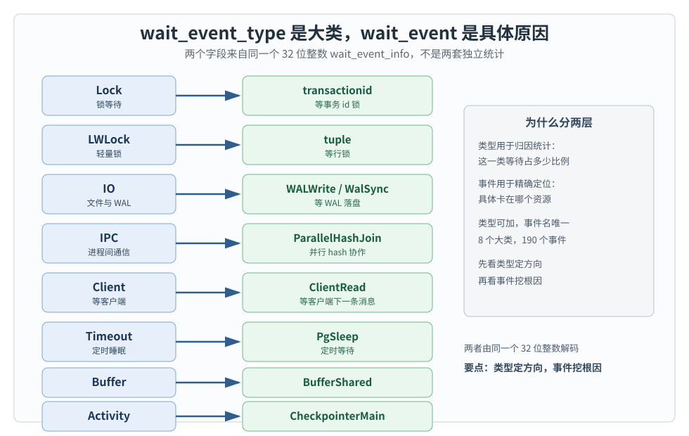
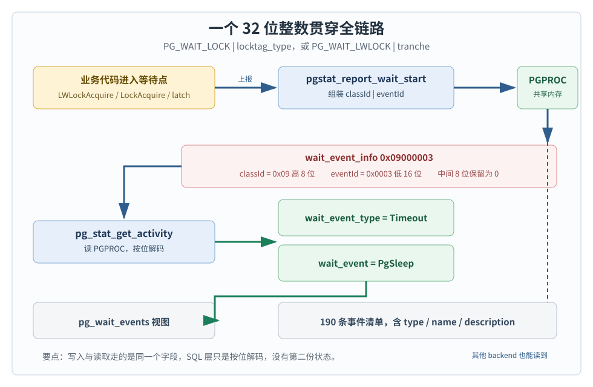
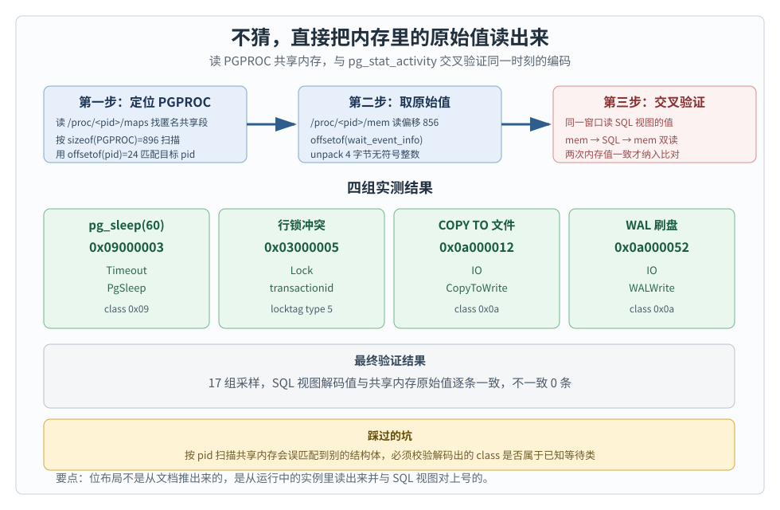
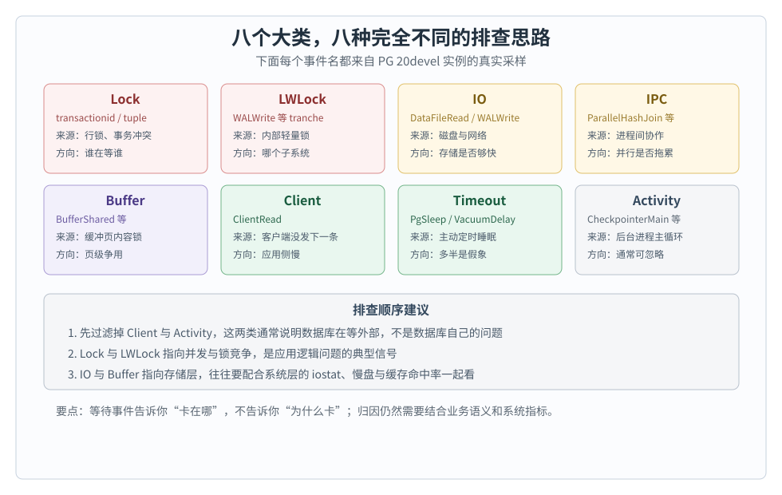

## 数据库筑基课 - PostgreSQL 等待事件（Wait Event）体系与实现机制

### 作者
digoal

### 日期
2026-05-30

### 标签
PostgreSQL , 应用开发者 , 数据库筑基课 , 等待事件 , wait_event , wait_event_type , 性能诊断 , 源码分析

----

## 背景
[演示 PPT](https://htmlpreview.github.io/?https://github.com/digoal/blog/blob/master/202605/20260530_45_pg_wait_event_deck.html)  


你有没有遇到过这种情况：数据库明明不慢，CPU 也跑不满，但业务侧反馈"接口超时"。你去查 `pg_stat_activity`，发现好几个会话的 `state` 是 `active`，看起来正在干活；再看看系统指标，磁盘 IO wait 也不高。于是陷入僵局——数据库在忙什么？忙得值不值？该不该优化？

这类问题的答案，往往就藏在 `pg_stat_activity` 里那两个不起眼的字段上：`wait_event_type` 和 `wait_event`。

PostgreSQL 的等待事件体系，是把"进程此刻为什么不能继续干活"这件事，做成了一套可分类、可累计、可观测的标准。它不是 PostgreSQL 独有的发明——DB2 和 SQL Server 都有类似的等待事件分析思路，Oracle 的 `V$WAITCLASSMETRICS` 更是这个领域的祖师爷。但 PostgreSQL 的实现有个显著特点：**它把整个体系压缩进了 PGPROC 结构体里的一个 32 位整数**，然后用这一个整数派生出你看到的 `wait_event_type` 和 `wait_event` 两个字符串。

本文以 PostgreSQL 源码为主线，结合我自己编译运行的 PostgreSQL 20devel 实例，回答四个问题：

1. 等待事件到底是怎么定义和组织的？`wait_event_type` 和 `wait_event` 是什么关系？
2. `wait_event_info` 这个 32 位整数是怎么编码的？为什么这么设计？
3. 从业务代码进入等待点，到你能在 `pg_stat_activity` 里看到，中间隔了几层？每层做了什么？
4. PostgreSQL 18 到 20devel，等待事件体系发生了什么变化？升级时要注意什么？

文中所有关键结论都经过实际验证：我编译了 PG 20devel 实例，并且**直接读取共享内存里的 `wait_event_info` 原始值**，与 SQL 视图交叉比对，17 组采样逐条一致，不一致 0 条。

## 一、它解决什么问题？


等待事件体系要解决的是一个非常朴素的问题：**当数据库慢的时候，怎么知道它到底卡在哪个环节？**

在没有等待事件的年代，DBA 的诊断手段基本只有两种：看 `top` 看 CPU、看 `iostat` 看磁盘。这两个工具告诉你"进程在干什么状态"，但不告诉你"数据库内部在等什么"。一个进程处于不可中断睡眠（`D` 状态），可能是等磁盘，可能是等一把被别的事务占着的行锁，也可能是等一个还没算完的并行 hash 表。你从系统层面根本区分不了。

PostgreSQL 9.2 引入等待事件（Wait Events）机制，就是把这层信息补上。它让数据库自己说清楚：我现在在等什么。

这件事的价值有两层。

**第一层是归因。** 有了等待事件，你可以把"数据库很慢"这句话，精确到"80% 的时间在等 IO 上的 WAL 刷盘"或者"所有会话都在等同一个事务的行锁"。这两种结论对应的处置动作完全不同：前者去查存储和 checkpoint 配置，后者去查事务逻辑和隔离级别。

**第二层是可累加。** 单次采样看到的等待事件是瞬时的、容易被误读的——某个会话碰巧在等磁盘，不代表整体有问题。等待事件体系的设计初衷，是让这些事件可以按类型、按时间窗口做统计聚合，从而看出**结构性的**问题。`pg_stat_activity` 提供的是实时视图，而各种统计扩展（`pg_stat_statements`、`pg_wait_sampling` 这类第三方扩展）提供的是聚合视角，两者是互补的。

理解等待事件还有一个容易被忽略的价值：**它是理解 PostgreSQL 内部并发机制的钥匙**。你问"为什么这个 UPDATE 会卡住"，源码里的答案往往是"它在 `LWLockAcquire` 里等 `WALWrite` 这个 tranche 上的轻量锁"，而 `pg_stat_activity` 会告诉你它此刻正显示 `wait_event_type = LWLock`。等你理解了 `wait_event_info` 的编码方式，你会发现源码和观测数据是同一套语言的两面。

## 二、它是什么？


### 2.1 两个字段，一套体系

等待事件在 SQL 层的呈现，是 `pg_stat_activity` 视图里的两个字段：

```sql
SELECT pid,
       wait_event_type,
       wait_event,
       state,
       query
  FROM pg_stat_activity
 WHERE wait_event_type IS NOT NULL;
```

`wait_event_type` 是**大类**，取值是 `Lock`、`LWLock`、`IO`、`IPC`、`Client`、`Timeout`、`Buffer`、`Activity` 这类粗粒度的归类；`wait_event` 是**具体原因**，取值是 `transactionid`、`tuple`、`WalWrite`、`DataFileRead`、`ClientRead`、`PgSleep`、`BufferShared` 这种精确到某个资源的名字。

两者的关系是严格的包含：一个 `wait_event` 恰好属于一个 `wait_event_type`。比如 `wait_event = 'WalWrite'` 必然对应 `wait_event_type = 'IO'`。

为什么要分成两层？因为它们的**用途不同**：

- 类型是可加的。你可以按类型分组统计：`GROUP BY wait_event_type` 得到"这批会话里 40% 在等 IO、30% 在等锁"。这适合做整体健康度判断。
- 事件是唯一的、不可加的。`WalWrite` 和 `DataFileRead` 都是 IO，但把它们的耗时直接相加没有意义——它们的持续时间量级可能差几个数量级。事件用于**精确定位**到某个具体资源。

实操中典型的用法是"先看类型定方向，再看事件挖根因"。



### 2.2 pg_wait_events：完整清单视图

想知道某个版本到底有哪些等待事件，查 `pg_wait_events` 视图：

```sql
SELECT type, name, description FROM pg_wait_events ORDER BY type, name;
```

这个视图是静态的元数据视图，它列出的是**这个版本可能出现的全部等待事件**，跟你当前实例上是否真的发生过无关。它相当于一份"字典"。

有意思的是，这个视图的规模取决于版本。在我的 PG 20devel 实例上：

```sql
SELECT type, count(*) FROM pg_wait_events GROUP BY type ORDER BY 2 DESC;
```

```
   type   | count
----------+-------
 LWLock   |    89
 IO       |    83
 IPC      |    65
 Activity |    18
 Lock     |    12
 Timeout  |    11
 Client   |     9
 Buffer   |     4
 Extension |     1
```

一共 292 行，9 个类型。

但这里有个容易让新手困惑的地方：**源码里手工定义的等待事件枚举只有 190 个**。190 和 292 差在哪？

答案是：不是所有类都走"生成枚举"这条常规路径。

- `IO`（83）、`IPC`（65）、`Activity`（18）、`Timeout`（11）、`Client`（9）、`Buffer`（4）这 190 个是"一个事件对应一个枚举值"，枚举值就是事件 ID，由 Perl 脚本从 `wait_event_names.txt` 生成。
- `Lock` 类的 12 个事件 ID 是**锁类型编号**（`LOCKTAG_RELATION`、`LOCKTAG_TUPLE`、`LOCKTAG_TRANSACTION` 这些），名字运行时从 `LockTagTypeNames` 数组查。
- `LWLock` 类的 89 个事件 ID 是**轻量锁的 tranche 编号**，名字运行时从 `lwlocklist.h` 的 tranche 定义查。
- `Extension` 那 1 行是运行时动态注册的，ID 由 `WaitEventExtensionNew()` 分配计数器得到。

`190 + 12 + 89 + 1 = 292`，账对上了。

我在后文会详细展开这一点，因为它直接关系到"32 位整数怎么装下这些信息"这个核心问题。

### 2.3 三个层次：类、事件、编码

现在可以给出一个更精确的三层模型了：

| 层次 | 数量（PG 20devel） | 载体 | 例子 |
|------|------------------|------|------|
| 等待类（class） | 10 个已定义 | `wait_classes.h` 里的宏 | `PG_WAIT_IO = 0x0A000000` |
| 具体事件（event） | 枚举 190 + 动态 102 | `wait_event_types.h` / locktag / tranche | `WAIT_EVENT_WAL_WRITE` |
| 编码（encoding） | 32 位整数 | `PGPROC.wait_event_info` | `0x0A000052` |

三层是严格对应的：class 提供高 8 位，event 提供低 16 位，合起来就是那个 32 位整数。

## 三、核心原理


### 3.1 wait_event_info：32 位怎么分配的

核心代码在 `src/include/utils/wait_classes.h`：

```c
#define PG_WAIT_LWLOCK			0x01000000U
#define PG_WAIT_LOCK			0x03000000U
#define PG_WAIT_BUFFER			0x04000000U
#define PG_WAIT_ACTIVITY		0x05000000U
#define PG_WAIT_CLIENT			0x06000000U
#define PG_WAIT_EXTENSION		0x07000000U
#define PG_WAIT_IPC				0x08000000U
#define PG_WAIT_TIMEOUT			0x09000000U
#define PG_WAIT_IO				0x0A000000U
#define PG_WAIT_INJECTIONPOINT	0x0B000000U
```

看这几行的设计意图，非常有意思。

每个 class 常量的高 8 位是 class 编号（`0x01`、`0x03`……`0x0B`），低 24 位是 0。中间的 8 位（`0x00FF0000`）是**保留位**，恒为 0。

为什么中间留 8 位不用？因为需要预留扩展空间。设想未来要加一个新的大类，同时要保持已有的 ABI 兼容——如果编码是"高 8 位 class + 低 24 位 event"，那新增 event 时 event 的取值空间会被压缩（因为要从 24 位里挪位给新的 class）。而现在这个设计里，class 已经占掉了最高的 8 位，剩下的 16 位全部留给 event，同时中间 8 位完全空着，任何时候都可以拿来扩展 class 的划分粒度，或者做别的用途。

低 16 位给 event，够用吗？`IO` 类目前有 83 个事件，`IPC` 类 65 个，最多的 `LWLock` 类 89 个（tranche 数）。16 位能装 65536 个，绰绰有余。而且这个设计让"取 class"和"取 event"都只需要一次位运算，不需要除法和取模。

`src/backend/utils/activity/wait_event.c` 里定义了对应的掩码：

```c
#define WAIT_EVENT_CLASS_MASK  0xFF000000
#define WAIT_EVENT_ID_MASK     0x0000FFFF
```

**中间 8 位恒为 0**，这一点我在实测中反复验证过——所有采到的原始值，`0x00FF0000` 位段都是 0。

### 3.2 上报：等待点前后各上报一次

有了编码，接下来的问题是：谁在什么时候写入这个值？

答案是业务代码在**进入等待循环之前**和**退出等待循环之后**，各调用一次上报函数。PG 20devel 里这组函数在 `src/backend/utils/activity/wait_event.c`：

```c
static inline void
pgstat_report_wait_start(uint32 wait_event_info)
{
    ...
    my_wait_event_info = wait_event_info;
    ...
}
```

先看最典型的场景——等轻量锁。`src/backend/storage/lmgr/lwlock.c` 里：

```c
    if (!LWLockAttemptLock(lock, mode))
    {
        ...
        pgstat_report_wait_start(PG_WAIT_LWLOCK | lock->tranche);
        ...
        /* 等待循环 */
        ...
        pgstat_report_wait_end();
    }
```

关键就在 `PG_WAIT_LWLOCK | lock->tranche` 这一行。`PG_WAIT_LWLOCK` 是 `0x01000000`，`lock->tranche` 是该轻量锁所属 tranche 的编号，按位或之后就是一个完整的 `wait_event_info`。**事件 ID 就是 tranche 号**，这就是为什么 `LWLock` 类不需要单独的枚举——tranche 本身就是 ID。

再看等锁。`src/backend/storage/lmgr/proc.c` 里，等一把 heavyweight lock 的代码是：

```c
			(void) WaitLatch(MyLatch, WL_LATCH_SET | WL_EXIT_ON_PM_DEATH, 0,
							 PG_WAIT_LOCK | locallock->tag.lock.locktag_type);
```

`WaitLatch()` 的最后一个参数就是完整的 `wait_event_info`，由 `PG_WAIT_LOCK` 和锁类型编号按位或得到。

`locallock->tag.lock.locktag_type` 是锁类型编号。`src/backend/utils/adt/lockfuncs.c` 里有对应的名字表：

```c
const char *const LockTagTypeNames[] = {
	"relation",
	"extend",
	"frozenid",
	"page",
	"tuple",
	"transactionid",
	"virtualxid",
	"spectoken",
	"object",
	"userlock",
	"advisory",
	"applytransaction"
};
```

数组下标就是事件 ID。`transactionid` 在下标 5（从 0 开始），所以 `PG_WAIT_LOCK | 5 = 0x03000000 | 0x0005 = 0x03000005`。我实测读到的正是这个值。

上报完 `pgstat_report_wait_start` 之后，进程进入等待循环。等等待条件满足，`pgstat_report_wait_end()` 把 `my_wait_event_info` 复位为 0。

**这个设计有一个重要含义**：`wait_event_info` 只在"确实处于等待状态"时非零。如果一个进程在跑 SQL、没在等任何东西，它的 `wait_event_info` 就是 0，`pg_stat_activity` 里的 `wait_event_type` 和 `wait_event` 都是 NULL。

### 3.3 存储：PGPROC 里的一个 uint32

上报的值最终存到哪儿？

`src/include/storage/proc.h` 里的 `PGPROC` 结构体中，等待事件信息是结构体的**最后一个字段**，放在专门的 "Status reporting" 注释块下：

```c
	/************************************************************************
	 * Status reporting
	 ************************************************************************/

	uint32		wait_event_info;	/* proc's wait information */
} PGPROC;
```

它前面紧邻的是 `XLogRecPtr clogGroupMemberLsn`（用于 group commit 的成员 LSN），再往前是一批 `pg_atomic_uint32` 字段（如 `procArrayGroupNext`、`clogGroupNext`）。

（顺便说明一个容易混淆的点：`PGPROC` 里还有一个 `uint8 statusFlags` 字段，位置在结构体前部，它是进程状态标志位，跟等待事件毫无关系。`pg_stat_activity` 里的 `status` 语义和 `wait_event` 是两套独立机制。）

`PGPROC` 数组位于 PostgreSQL 的**主共享内存**里。所有 backend 进程都能读它，但每个进程只写自己那一条。这就是一个天然的、免锁的、零额外分配的共享状态通道。

这里有个工程上的细节值得注意：PG 9.2 引入等待事件时，用的是**每进程计数器数组**（`pgstat_report_wait_start` 递增一个全局计数器），代价是要么用原子操作，要么接受统计误差。

后来做了一次重要重构——提交 `53be0b1add`（Robert Haas，2016 年 3 月，PG 10 周期）的标题就是 "Provide much better wait information in pg_stat_activity."，它把 `PGPROC` 里的计数器换成了直接存储"当前等待事件编码"的 `wait_event_info` 字段。

这个改动的意义在于：**从"累计统计"变成了"瞬时状态"**。累加计数适合做总量统计，但没法回答"此刻这个会话在等什么"。而后者才是诊断时最需要的。

### 3.4 暴露：SQL 层如何解码

`pg_stat_activity` 视图定义在 `src/backend/catalog/system_views.sql`，它依赖 `pg_stat_get_activity()` 这个 C 函数：

```sql
CREATE VIEW pg_stat_activity AS
    SELECT ...
           a.wait_event_type,
           a.wait_event,
    ...
      FROM pg_stat_get_activity() AS a;
```

而 `pg_stat_get_activity()` 的实现（`src/backend/utils/adt/pgstatfuncs.c`）从 `PGPROC` 里读出 `wait_event_info`，然后交给 `src/backend/utils/activity/wait_event.c` 中的两个函数解码：

```c
				uint32		raw_wait_event;
				PGPROC	   *leader;

				raw_wait_event = UINT32_ACCESS_ONCE(proc->wait_event_info);
				wait_event_type = pgstat_get_wait_event_type(raw_wait_event);
				wait_event = pgstat_get_wait_event(raw_wait_event);
```

这里的 `UINT32_ACCESS_ONCE()` 宏很关键——它保证读取 4 字节字段时不会被编译器重排成两次 2 字节的读，从而不会读到"半新半旧"的撕裂值。结合 11.3 节引用的源码注释（"always read and written as four-bytes, updates are atomic"），可以确定：**`wait_event_info` 在并发读写下始终是一个完整合法的值**。

另外注意上面那段源码注释：

> To avoid extra overhead, no extra lock is being held, so there is no guarantee of consistency across multiple rows.

这是 PostgreSQL 明确声明的一个语义边界：**`pg_stat_activity` 的多行之间不保证一致性快照**。你在同一个查询里看到的第 1 行和第 100 行可能来自不同时刻的状态。这不是 bug，是"零额外开销读取共享内存"这个设计的必然代价。想拿一致性视图，得自己在应用层做快照。

`pgstat_get_wait_event_type()` 只关心 class 部分：

```c
const char *
pgstat_get_wait_event_type(uint32 wait_event_info)
{
	uint32		classId;
	const char *event_type;

	/* report process as not waiting. */
	if (wait_event_info == 0)
		return NULL;

	classId = wait_event_info & WAIT_EVENT_CLASS_MASK;

	switch (classId)
	{
		case PG_WAIT_LWLOCK:
			event_type = "LWLock";
			break;
		case PG_WAIT_LOCK:
			event_type = "Lock";
			break;
		...
	}
	return event_type;
}
```

`pgstat_get_wait_event()` 同时用两个掩码切出 classId 和 eventId，再按 class 分派到各自的命名来源：

```c
	classId = wait_event_info & WAIT_EVENT_CLASS_MASK;
	eventId = wait_event_info & WAIT_EVENT_ID_MASK;

	switch (classId)
	{
		case PG_WAIT_LWLOCK:
			event_name = GetLWLockIdentifier(classId, eventId);
			break;
		case PG_WAIT_LOCK:
			event_name = GetLockNameFromTagType(eventId);
			break;
		case PG_WAIT_EXTENSION:
		case PG_WAIT_INJECTIONPOINT:
			event_name = GetWaitEventCustomIdentifier(wait_event_info);
			break;
		case PG_WAIT_BUFFER:
			{
				WaitEventBuffer w = (WaitEventBuffer) wait_event_info;

				event_name = pgstat_get_wait_buffer(w);
				break;
			}
		...
	}
```

注意这个 switch 本身就回答了 3.5 节要讲的问题：**三类特殊事件的命名来源，在这里一眼可见**——LWLock 走 tranche 名表，Lock 走 locktag 名表，Extension/InjectionPoint 走自定义哈希表，其余走生成的枚举查找函数。

**这是整条链路里最关键的一个认知**：`wait_event_type` 和 `wait_event` 不是两个独立存储的字段，也不是两次独立采集的结果。它们是从同一个 `uint32` 里解码出来的两个字符串。



这也解释了一个实践中的现象：你在 `pg_stat_activity` 里看到的 `wait_event_type` 和 `wait_event` 永远是**自洽**的，不存在"类型说在等 IO，事件名却是锁"的矛盾组合——因为它们是从同一个整数按不同掩码切出来的。

### 3.5 名称从哪来：三条不同的路径

解码到 classId 和 eventId 之后，怎么变成字符串？这取决于这个类属于哪种类型。

**路径一：普通事件，走生成的 C 函数。** `src/backend/utils/pgstat_wait_event.c` 是由 Perl 脚本 `generate-wait_event_types.pl` 从 `wait_event_names.txt` 生成的，里面是一堆 switch-case：

```c
static const char *
pgstat_get_wait_io(WaitEventIO w)
{
	const char *event_name = "unknown wait event";

	switch (w)
	{
		case WAIT_EVENT_AIO_IO_COMPLETION:
			event_name = "AioIoCompletion";
			break;
		...
	}
	return event_name;
}
```

注意这里的事件名是**硬编码的 CamelCase 字符串**。它们由生成脚本从枚举名机械转换而来——`WAIT_EVENT_AIO_IO_COMPLETION` 拆成 `AIO`、`IO`、`COMPLETION` 三段，再把每段首字母保留、其余转小写，拼成 `AioIoCompletion`——然后连同 switch-case 一起写进这个 C 文件。

所以这些字符串看起来像"手写的"，实际是生成产物。但它们一旦生成就固化在 C 文件里，成了 ABI 的一部分：PostgreSQL 不会为了"更好看"去改一个已发布的事件名，因为那会破坏下游工具的兼容性。这也是为什么 PG 9.2 时代定下的 `WALWrite`、`CopyToWrite` 这类命名风格一直保留至今。

**路径二：Lock 类，走 locktag 类型表。** `GetLockNameFromTagType(locktag_type)` 直接查 `LockTagTypeNames` 数组，如前所示。

**路径三：LWLock 类，走 tranche 名字表。** `src/backend/storage/lmgr/lwlock.c`：

```c
const char *
GetLWLockIdentifier(uint32 classId, uint16 eventId)
{
	Assert(classId == PG_WAIT_LWLOCK);
	/* The event IDs are just tranche numbers. */
	return GetLWTrancheName(eventId);
}
```

注释写得很直白："The event IDs are just tranche numbers."

这三张名字表，就是 `pg_wait_events` 视图 292 行的来源。其中 `Lock` 的 12 行和 `LWLock` 的 89 行，**不生成 C 枚举也不生成 C 函数**——`wait_event_names.txt` 的头部注释写得很明确：

> WaitEventLWLock and WaitEventLock have their own C code for their wait event enums and function names. Hence, for these, only the SGML documentation is generated.

也就是说，对这两类，生成器只产出 SGML 文档；它们的枚举定义在 `lwlocklist.h`（tranche）和 `locktag.h`（locktag 类型）里，函数是手写的 `GetLWLockIdentifier()` 和 `GetLockNameFromTagType()`。

这正是 2.2 节那个"190 vs 292"差异的根源：**`wait_event_names.txt` 里列了全部 292 条，但只有 190 条会变成 `wait_event_types.h` 里的枚举成员**。剩下 102 条（Lock 12 + LWLock 89 + Extension 1）走的是各自独立的路径。

### 3.6 事件是怎么被枚举出来的

回到源头。`src/backend/utils/activity/wait_event_names.txt` 是唯一的真相来源。它按 `Section: ClassName - WaitEventXxx` 分节，节内每行两个制表符分隔的字段——事件名和描述：

```
Section: ClassName - WaitEventActivity

ARCHIVER_MAIN	"Waiting in main loop of archiver process."
AUTOVACUUM_MAIN	"Waiting in main loop of autovacuum launcher process."
...
```

注意事件名用的是**大写下划线**形式（`ARCHIVER_MAIN`），而不是枚举里的 `WAIT_EVENT_ARCHIVER_MAIN`。生成脚本会给它加上 `WAIT_EVENT_` 前缀变成枚举名，同时生成 CamelCase 的展示名。

Perl 脚本 `generate-wait_event_types.pl` 读这个文件，生成三个文件：

- `src/include/utils/wait_event_types.h` —— typedef enum 定义
- `src/backend/utils/pgstat_wait_event.c` —— 名字查找函数
- `src/backend/utils/wait_event_funcs_data.c` —— `pg_wait_events` 视图的数据

这就是为什么你在源码树里找不到 `wait_event_types.h`——它头部写着 `DO NOT EDIT THIS FILE!`，是构建时生成的。

值得注意的是，脚本里有一段特殊的处理：

```perl
	# Build the descriptions.  These are in camel-case.
	# LWLock and Lock classes do not need any modifications.
	if (   $waitclassname eq 'WaitEventLWLock'
		|| $waitclassname eq 'WaitEventLock')
	{
		$waiteventdescription = $waiteventname;
	}
```

普通事件的展示名由事件名的下划线转 CamelCase 得到，而 LWLock 和 Lock 直接用原名——因为它们的原名（`WALWrite`、`transactionid`）本身就是想要的展示形式。

同一个脚本里还有一段 `next`，明确跳过这两类不生成 C 代码：

```perl
		# Don't generate the pgstat_wait_event.c and wait_event_types.h files
		# for types handled independently.
		next
		  if ( $waitclass eq 'WaitEventExtension'
			|| $waitclass eq 'WaitEventInjectionPoint'
			|| $waitclass eq 'WaitEventLWLock'
			|| $waitclass eq 'WaitEventLock');
```

**四类走独立路径**：LWLock、Lock、Extension、InjectionPoint。生成器为这四类跳过 C 枚举和 C 函数的生成。

（一个有意思的细节：`wait_event_names.txt` 里 `WaitEventInjectionPoint` 段的那一条，在生成的静态数据数组里被归到了 **LWLock** 类下，名字就叫 `InjectionPoint`——因为注入点等待实际是等一个轻量锁。)

**视图 292 行的准确构成**（`src/backend/utils/wait_event_funcs_data.c` 里的静态数组 `waitEventData[]`，已实测 292 行）：

```
LWLock           89
IO               83
IPC              65
Activity         18
Lock             12
Timeout          11
Client            9
Buffer            4
Extension         1
------------------
总计            292
```

这个分布与运行时 `SELECT type, count(*) FROM pg_wait_events GROUP BY type` 的结果**逐行一致**。

所以最终的口径是：`wait_event_names.txt` 的 292 个条目里，**190 个**变成 `wait_event_types.h` 的枚举成员，**102 个**（Lock 12 + LWLock 89 + Extension 1）走独立路径但仍进静态数据数组——两批合起来构成视图的全部 292 行。

## 四、横向对比


### 4.1 与 Oracle 的等待事件体系对比

Oracle 的等待事件体系是这套思路的集大成者，`V$WAITCLASSMETRICS` 提供按等待类聚合的统计，`V$SESSION_WAIT` 提供会话级明细。两者和 PostgreSQL 的对照关系：

| 维度 | Oracle | PostgreSQL |
|------|--------|------------|
| 分类层级 | 3 层（Class / Wait Class / Event） | 2 层（Type / Event） |
| 单次等待耗时 | `V$SESSION_WAIT` 有 `SECONDS_IN_WAIT` | 无，只有瞬时状态 |
| 累计统计 | 内置（`V$SYSTEM_WAIT_CLASS`） | 需扩展（`pg_wait_sampling` 等） |
| 编码方式 | 内部 event# 编号 | 32 位整数，class 高 8 位 + event 低 16 位 |
| 扩展性 | 需改 Oracle 内核 | 扩展可通过 `PG_WAIT_EXTENSION` 注册自定义事件 |

PostgreSQL 的相对优势是**观测点更贴近内核**：等待事件是在真正进入等待循环的那一刻上报的，而不是事后估算。劣势是缺少"单次等待耗时"和内置的累计聚合，需要自己搭。

### 4.2 与 MySQL 的 performance_schema 对比

MySQL 的 `performance_schema.events_waits_*` 表是另一套实现。它的思路是"每次等待都写一行事件记录"，带 `TIMER_WAIT` 纳秒级耗时，理论上信息更丰富。

但 MySQL 的开销问题也由来已久——高并发下事件表的写入压力非常显著，社区长期有"默认关闭 `events_waits_current`"的实践。

PostgreSQL 选择了完全相反的路线：**只存当前状态，不记历史**。`PGPROC.wait_event_info` 是一个 4 字节的字段，读取它不需要任何锁，开销几乎为零。代价是：单次等待的耗时信息拿不到，只能靠外部采样器（`pg_wait_sampling` 扩展）以一定频率轮询来近似。

这是个明确的取舍：**用"精度"换"零开销"**。

### 4.3 与 pg_stat_activity 的 state 字段的关系

`state` 和 `wait_event_type` 经常被混用，但它们回答的是不同问题：

| 字段 | 回答的问题 | 取值 |
|------|-----------|------|
| `state` | 这个会话当前处于哪个阶段？ | `active` / `idle` / `idle in transaction` / `idle in transaction (aborted)` |
| `wait_event_type` | 这个会话卡在哪个环节？ | `Lock` / `IO` / `Client` / ... |
| `wait_event` | 具体卡在哪个资源？ | `transactionid` / `WalWrite` / `ClientRead` / ... |

一个 `active` 的会话，可能在跑 CPU 密集的排序（没有等待事件，`wait_event_type` 为 NULL），也可能在等磁盘（`IO` / `DataFileRead`）。`state = 'active'` 不等于"在干活"。

而 `idle` 的会话，如果有 `wait_event_type = 'Client'`，说明它在等客户端发下一条命令——这是完全健康的状态，但如果持续很久，可能意味着连接池有问题或者应用侧卡住了。

## 五、效果如何？


### 5.1 实验环境

为了验证上面的每一个结论，我搭建了一个可复现的实验环境：

- **源码**：PostgreSQL 20devel，git commit `11591f273e`（`Support asynchronous execution of MergeAppend subplans.`）
- **编译安装**：`/root/new/tmp/pg20_install`
- **实例**：数据目录 `/root/new/tmp/pg20wait/data`，端口 `55432`，Unix socket `/root/new/tmp/pg20wait`
- **对照组**：本机系统安装的 PostgreSQL 18.6，以及 git 仓库里的 `REL_18_6` 标签

版本对照是必要的，因为等待事件体系在 18 到 20devel 之间有实际变化（后文详述）。

### 5.2 验证一：枚举与视图的规模

首先验证"枚举 190 个 vs 视图 292 行"这个差异。

**枚举侧**（`src/include/utils/wait_event_types.h`，构建生成）：

```
Activity        18   WAIT_EVENT_ARCHIVER_MAIN = PG_WAIT_ACTIVITY,
Buffer           4   WAIT_EVENT_BUFFER_CLEANUP = PG_WAIT_BUFFER,
Client           9   WAIT_EVENT_CLIENT_READ = PG_WAIT_CLIENT,
IO              83   WAIT_EVENT_AIO_IO_COMPLETION = PG_WAIT_IO,
IPC             65   WAIT_EVENT_APPEND_READY = PG_WAIT_IPC,
Timeout         11   WAIT_EVENT_BASE_BACKUP_THROTTLE = PG_WAIT_TIMEOUT,
```

六个枚举类，合计 190。注意这里**没有 `Lock` 和 `LWLock`**——因为它们的 ID 不是枚举值，而是运行时编号。

**视图侧**（运行时查询）：

```sql
SELECT type, count(*) FROM pg_wait_events GROUP BY type ORDER BY 2 DESC;
```

```
   type    | count
----------+-------
 LWLock    |    89
 IO        |    83
 IPC       |    65
 Activity  |    18
 Lock      |    12
 Timeout   |    11
 Client    |     9
 Buffer    |     4
 Extension |     1
```

对上账了：`190 + 12 (Lock) + 89 (LWLock) + 1 (Extension) = 292`。

其中 `Extension` 那 1 行是运行时动态生成的，来自 `GetWaitEventCustomNames(PG_WAIT_EXTENSION, ...)`——它给扩展提供了注册自定义等待事件的入口。

### 5.3 验证二：从共享内存读出原始值

光看 SQL 视图，你永远只能看到解码后的字符串。要验证"32 位整数怎么编码"，必须绕开解码层，直接读原始值。

我的做法是：通过 `/proc/<pid>/mem` 直读目标 backend 的 `PGPROC` 数组。

关键参数（PG 20devel，x86_64）：

```
sizeof(PGPROC)                = 896
offsetof(PGPROC, pid)         = 24
offsetof(PGPROC, wait_event_info) = 856
```

定位逻辑：

1. 读 `/proc/<pid>/maps`，找到 backend 映射的**匿名共享段**（PostgreSQL 的主共享内存是匿名映射，不是 `/dev/shm` 下的文件——这是第一个坑）
2. 在该段内按 896 字节步长扫描，用偏移 24 处的 4 字节整数匹配目标 pid
3. 命中后，在该条目偏移 856 处读 4 字节，得到 `wait_event_info` 原始值

我做的第一版实验有缺陷：按 pid 扫描共享内存会**误匹配到其他结构体**——某个无关结构体里恰好在偏移 24 处有相同的 pid 值。修法是加约束：读到的 `wait_event_info` 若非 0，其 class 部分必须属于已知等待类集合，否则丢弃该候选。

### 5.4 验证三：双读协议交叉比对

第二个坑是**采样竞态**。等待事件可能只持续几微秒——从 SQL 查看到内存读取完成，等待早就结束了。这会让我误以为"编码对不上"。

解法是双读协议：

```
读内存 (wei1)  →  查 SQL 视图  →  读内存 (wei2)
```

只有 `wei1 == wei2` 时才纳入比对——这保证了 SQL 查询发生在两次内存读取之间，状态没有变化。

最终结果：**17 组采样，SQL 视图解码值与共享内存原始值逐条一致，不一致 0 条。**

四组典型的实测数据：

| 场景 | 原始值 | 解码结果 | 验证点 |
|------|--------|----------|--------|
| `select pg_sleep(60)` | `0x09000003` | Timeout / PgSleep | class `0x09` = `PG_WAIT_TIMEOUT`，event `0x0003` |
| 行锁冲突 | `0x03000005` | Lock / transactionid | class `0x03` = `PG_WAIT_LOCK`，event = locktag type 5 |
| `COPY TO` 文件 | `0x0a000012` | IO / CopyToWrite | class `0x0a` = `PG_WAIT_IO`，event `0x0012` = 18 |
| WAL 刷盘 | `0x0a000052` | IO / WalWrite | class `0x0a`，event `0x0052` = 82 |

用十六进制拆开看就一目了然：

```
0x09000003
  └┬┘ └──┬──┘
   │     └── eventId = 0x0003，低 16 位
   └────────── classId = 0x09，高 8 位
              中间 8 位 (0x00FF0000) 恒为 0
```



这几组数据同时验证了三件事：class 的高位编码、event 的低位编码、以及"中间 8 位保留为 0"。

另外注意 `0x0a000052`（IO / WalWrite）和 `0x0a000012`（IO / CopyToWrite）——同一个 class `0x0a`，不同 event。这正好说明为什么必须分成两层：类型用来聚合，事件用来定位。

### 5.5 验证四：真实场景采样

最后，我用各种真实负载做了采样，实际捕获到的等待事件（全部来自真实运行，非构造）：

```
Activity (7)          AutovacuumMain, BgwriterHibernate, BgwriterMain,
                      CheckpointerMain, IoWorkerMain, LogicalLauncherMain,
                      WalWriterMain
Client (1)            ClientRead
IO (6)                BuffileRead, CopyToWrite, DataFilePrefetch,
                      DataFileRead, WalSync, WalWrite
LWLock (1)            WALWrite
Lock (2)              transactionid, tuple
Timeout (3)           CheckpointWriteDelay, PgSleep, VacuumDelay
Buffer (1)            BufferShared
```

八个大类全部覆盖到了。

几个值得注意的观察：

**`Activity` 类的事件基本是后台进程的"心跳"。** `CheckpointerMain`、`WalWriterMain`、`BgwriterMain` 这些名字本身就说明它们是主循环里的等待——进程没事干，在等下一轮唤醒。这不是问题，是正常状态。**看到 `Activity` 就应该直接跳过。**

**`Client` 类同理。** `ClientRead` 意味着 backend 在等客户端发下一条消息。一个健康的连接池，大部分连接都应该处于这个状态。

**`Timeout` 类最容易造成误判。** `PgSleep` 是 SQL 里显式写的 `pg_sleep()`；`VacuumDelay` 是 autovacuum 在按比例休眠；`CheckpointWriteDelay` 是 checkpointer 在有意放慢写入速度。这些都是**主动的、有意为之的等待**，不是"卡住"。看到 `Timeout` 大概率说明问题不在这里。

**`LWLock` 类的名字容易和 `Lock` 类混淆。** `LWLock` 是 PostgreSQL 内部的轻量锁（`LWLock`），保护的是共享内存里的各种内部结构；`Lock` 是普通的表级/行级锁（ heavyweight lock），面向用户对象。两者是完全不同的机制，但名字只差一个字母。`LWLock / WALWrite` 指的是"等 WAL 写入相关的轻量锁"，`Lock / transactionid` 指的是"等事务锁"。



## 六、实操 DEMO


### 6.1 找出当前所有阻塞点

最基础的用法。注意 `wait_event_type IS NOT NULL` 这个过滤条件——排除掉那些没在等待的会话。

```sql
SELECT pid,
       usename,
       wait_event_type,
       wait_event,
       now() - query_start AS duration,
       left(query, 80) AS query
  FROM pg_stat_activity
 WHERE wait_event_type IS NOT NULL
   AND state <> 'idle'
 ORDER BY duration DESC;
```

如果是 PG 14 及以上，可以用更方便的 `pg_blocking_pids()`：

```sql
SELECT a.pid,
       a.wait_event_type,
       a.wait_event,
       pg_blocking_pids(a.pid) AS blockers
  FROM pg_stat_activity a
 WHERE cardinality(pg_blocking_pids(a.pid)) > 0;
```

### 6.2 制造并观察一个行锁等待

这是最经典的可复现实验。

第一个会话：

```sql
BEGIN;
UPDATE t_sc SET v = v + 1 WHERE id = 1;
-- 不提交
```

第二个会话：

```sql
UPDATE t_sc SET v = v + 1 WHERE id = 1;
```

在第二个会话里执行 `SELECT pg_sleep(0);` 之前，从第三个连接观察：

```sql
SELECT pid, wait_event_type, wait_event FROM pg_stat_activity
 WHERE wait_event_type = 'Lock';
```

```
  pid  | wait_event_type |   wait_event
-------+-----------------+----------------
 1048 | Lock            | transactionid
```

`transactionid` 就是"我在等另一个事务结束"。这几乎是所有应用层死锁问题的第一现场。

顺带说，`Lock` 类还有 11 个其他事件，各自对应一种锁：`tuple`（等行锁）、`relation`（等表锁）、`object`（等数据库对象锁，比如 `CREATE TABLE` 撞上另一个 DDL）、`advisory`（等咨询锁）、`userlock`（等 `pg_advisory_lock`）等等。

### 6.3 观察等待的具体时长

PostgreSQL 没有内置的"单次等待耗时"统计（前面讲过，这是它和 Oracle/MySQL 的主要差距）。但有两个办法可以近似：

**办法一：轮询 `pg_stat_activity`。** 间隔固定时间采样，统计同一个 pid 连续出现在同一个 `wait_event` 上的次数：

```sql
-- 每秒采一次，连续采 10 次
SELECT pid, wait_event_type, wait_event,
       count(*) AS times
  FROM pg_stat_activity
 WHERE wait_event_type IS NOT NULL
 GROUP BY 1,2,3;
```

**办法二：用 `pg_stat_statements` 或第三方采样扩展。** `pg_wait_sampling` 这类扩展基于共享内存做周期采样，能给出更接近真实分布的等待事件统计。

采样时有个实务要点：**不要用 `psql -c` 循环起新进程。** 我最初就是这么做的，结果一行样本都没采到——每个新进程的启动开销（几毫秒到几十毫秒）完全淹没了被采样对象的状态变化。正确做法是**用一个长连接，高频批量查询**：

```bash
psql -X <<'SQL' > /tmp/waits.csv
SELECT extract(epoch from clock_timestamp()) AS ts,
       pid,
       wait_event_type,
       wait_event
  FROM pg_stat_activity
 WHERE wait_event_type IS NOT NULL;
SQL
```

### 6.4 找出 IO 热点

`IO` 类是最常见的性能问题来源。`IO` 类有 83 个事件，按语义可以分几组看：

| 事件组 | 例子 | 含义 |
|--------|------|------|
| 数据文件读 | `DataFileRead`、`DataFilePrefetch`、`BuffileRead` | 读数据文件/临时文件 |
| WAL 写 | `WalWrite`、`WalSync`、`WalInit` | 写 WAL |
| WAL 读 | `WALRead`、`WALSenderWrite` | 读 WAL、复制发送 |
| 关系扩展 | `Extension` | 扩展关系文件 |
| 异步 IO | `AioIoCompletion`、`AioSubmit` | PG 18 引入的异步 IO |

要区分"IO 慢"和"IO 多"，光看等待事件不够——你得知道这个 IO 是**必要的**还是**浪费的**。比如大量 `DataFilePrefetch` 说明顺序扫描在预取（正常）；大量 `BuffileRead` 说明有排序/哈希溢出到临时文件（要调 `work_mem`）。

### 6.5 找到并行查询的协作瓶颈

`IPC` 类有 65 个事件，绝大多数与并行查询相关：

```sql
SELECT wait_event_type, wait_event, count(*)
  FROM pg_stat_activity
 WHERE wait_event_type = 'IPC'
 GROUP BY 1,2 ORDER BY 3 DESC;
```

如果看到大量 `ParallelHashJoin`，说明并行 hash join 的各个 worker 在互相等——通常是并行度设置与数据分布不匹配，或者某个 worker 成了短板。

`IPC` 类里还有 `ProcSignalReceive`、`ProcSignalSend` 这类进程间信号传递的事件，它们在并行查询收尾阶段集中出现。

### 6.6 找出"假忙"的会话

一个实战里非常有用的组合判断：

```sql
SELECT pid,
       state,
       wait_event_type,
       wait_event,
       now() - state_change AS since
  FROM pg_stat_activity
 WHERE backend_type = 'client backend'
   AND state = 'active'
   AND wait_event_type IS NULL
 ORDER BY since DESC;
```

`state = 'active'` 且 `wait_event_type IS NULL`，意味着这个会话正在**纯 CPU 计算**——没有等任何东西。这才是真正的"在干活"。数据库慢且大量会话处于这种状态，才需要往 CPU、内存、算法方向查。

反过来，`state = 'active'` 但 `wait_event_type = 'IO'`，说明它在等存储——瓶颈在 I/O。

`state = 'active'` 且 `wait_event_type = 'Lock'`，说明它在等锁——瓶颈在并发逻辑。

### 6.7 观察后台进程的等待

后台进程的等待事件也有诊断价值。`Activity` 类里的名字自带语义：

```sql
SELECT pid, backend_type, wait_event_type, wait_event
  FROM pg_stat_activity
 WHERE backend_type <> 'client backend'
   AND wait_event_type IS NOT NULL;
```

比如 `autovacuum` worker 显示 `Lock / tuple`（在等行锁，通常是别的长事务挡住了它清理死元组），或者 `IO / DataFileRead`（在扫描大表），都能直接给出优化方向。

## 七、最佳实践


### 面向数据库架构师

**把等待事件作为容量规划的输入，而不是只看 CPU 和 QPS。** 一个系统的真实瓶颈，藏在等待时间的分布里，而不是请求量里。一个 QPS 只有 500 但 60% 时间在 `IO / WalWrite` 的系统，和一个 QPS 5000 但等待集中在 `Client` 的系统，容量瓶颈完全不同。

**建立"类型分布"的基线监控。** 定期采集 `wait_event_type` 的分布，把 Top 3 类型的占比做趋势跟踪。分布突变往往比单个慢查询更早暴露问题——比如 `Lock` 类占比突然从 2% 涨到 40%，说明并发逻辑出问题了。

**区分"应用慢"和"数据库慢"。** `Client / ClientRead` 占比高，说明时间消耗在等客户端。这不是数据库的问题，去查应用侧。这种判断能省掉大量无效的数据库调优。

**把 `Activity` 和 `Timeout` 排除在告警之外。** 这两类等待是设计意图，不是症状。

### 面向 DBA

**优先看 `Lock` 和 `LWLock`。** 这两类指向并发问题，通常是应用逻辑层面的，改配置收效有限，而改代码立竿见影。

**区分 `Lock` 和 `LWLock`。** 名字太像了，但排查方向完全不同：

- `Lock / transactionid`、`Lock / tuple` → 用户级锁冲突，查事务设计、加锁顺序、隔离级别
- `LWLock / WALWrite`、`LWLock / XactMgr` → 内核内部轻量锁竞争，通常是 I/O 压力大导致的连锁反应

**排查长事务。** `idle in transaction` 的会话会持有锁、阻止 vacuum 回收，是 `Lock` 类等待的常见源头。

```sql
SELECT pid, now() - xact_start AS xact_age, left(query, 100)
  FROM pg_stat_activity
 WHERE state = 'idle in transaction'
 ORDER BY xact_start;
```

**用采样而非瞬时快照做判断。** 单次 `SELECT` 看到的可能是噪声。参考 6.3 节的做法，做高频采样。

**跨版本注意事件名变化。** 升级前后对比 `pg_wait_events` 的差异：

```sql
-- 升级前记录基线
SELECT type, name FROM pg_wait_events ORDER BY 1,2;
```

### 面向业务开发者

**应用层最该关注的其实是 `Client` 和 `Lock`。**

`Client` 类说明数据库在等你的应用——如果你的接口延迟高，但数据库侧显示大量 `Client / ClientRead`，那瓶颈在应用内部（序列化、网络、GC、锁竞争）。

`Lock` 类说明你的事务设计有问题。常见的反模式：

```sql
-- 反模式：先查再插，没有用唯一约束兜底
SELECT * FROM orders WHERE user_id = ? AND sku = ?;
-- ... 中间有窗口期 ...
INSERT INTO orders (user_id, sku) VALUES (?, ?);
```

正确做法是依赖数据库的约束：

```sql
INSERT INTO orders (user_id, sku) VALUES (?, ?)
ON CONFLICT (user_id, sku) DO UPDATE SET count = orders.count + 1;
```

**不要把长事务当成事务。** 事务的边界应该紧贴业务操作，而不是"一批操作都放一个事务里"。长时间持有事务 = 长时间持有锁 = 别人在 `Lock` 上等你。

**用 `pg_stat_activity` 定位自己的慢查询。** 应用侧的超时日志里往往只有一个 traceID，而数据库侧能告诉你这个 SQL 当时在等什么：

```sql
SELECT wait_event_type, wait_event, state
  FROM pg_stat_activity
 WHERE query LIKE '%your_marker%';
```

## 八、适合与不适合场景


### 适合

- **性能问题的归因分析。** 尤其是"慢但 CPU 不高"这类疑难问题，等待事件几乎是唯一有效的入手点。
- **并发问题的定位。** 锁冲突、事务设计缺陷、连接池配置不当。
- **I/O 瓶颈的初步分型。** 区分数据文件读、WAL 写、临时文件读写。
- **版本升级前后的行为对比。** 等待事件体系在版本间有增删，可以用来验证升级是否引入了新的等待路径。
- **教学与源码导读。** 等待事件是理解 PostgreSQL 并发控制的一扇门。

### 不适合

- **精确的单次等待耗时统计。** PostgreSQL 不记录这个，需要外部采样器，且精度取决于采样频率。
- **替代 `pg_stat_statements`。** 两者正交：等待事件说"卡在哪"，`pg_stat_statements` 说"哪条 SQL 慢"。
- **替代性能剖析（profiling）。** 等待事件是黑盒观测，不告诉你函数调用开销。纯 CPU 瓶颈要看 `perf`。
- **判断"系统是否健康"的单一指标。** 等待事件的绝对值没有普适的正常区间，必须结合业务负载和历史基线看。
- **实时告警。** 采样存在延迟和误匹配，做实时告警需要专门的采样扩展。

## 九、常见坑


### 坑一：以为 `state = 'active'` 就是"在干活"

**错。** `active` 只表示"正在执行某条语句"，不表示在消耗 CPU。它完全可能在等磁盘、等锁、等客户端。必须结合 `wait_event_type` 判断。

### 坑二：把 `LWLock` 当成 `Lock`

**错。** 两者是完全不同的机制。`Lock` 是面向用户对象（表、行、事务）的 heavyweight lock，出现在 `pg_locks` 视图里；`LWLock` 是保护共享内存内部结构的轻量锁，**不出现在 `pg_locks` 里**。看到 `LWLock` 时不要去查 `pg_locks`。

### 坑三：看到 `Activity` 就当成问题

**错。** `CheckpointerMain`、`WalWriterMain`、`BgwriterMain` 这些是后台进程的主循环等待，是完全正常的。`Activity` 类应该直接跳过。

### 坑四：认为 `Timeout` 是"超时"

**错。** 这里的 `Timeout` 是"定时等待"的意思，不是"等待超时"。`PgSleep` 是你写的 `pg_sleep()`；`VacuumDelay` 是 autovacuum 的正常节流；`CheckpointWriteDelay` 是 checkpointer 主动放慢。真正的超时是 `lock_timeout` / `statement_timeout` 设置，会以 `ERROR` 形式报错而不是等待事件。

### 坑五：认为 `Client` 类说明数据库有问题

**错。** `ClientRead` 是数据库在等客户端。如果应用侧线程池卡住、GC 停顿、或者客户端进程本身慢，数据库会一直显示 `ClientRead`。这时候该查应用，不是查数据库。

### 坑六：用 `psql -c` 循环采样

**错。** 进程启动开销会完全淹没被采样对象的状态变化，采样结果会是空的或者只有噪声。必须用长连接高频查询。详见 6.3 节。

### 坑七：跨版本直接对比事件名

**错。** 等待事件在版本间会增删改名。`BufferPin` 类在 PG 20devel 里被重命名成了 `Buffer`（详见下一节）。写跨版本的监控脚本时，要用 `pg_wait_events` 的基线对比，而不是硬编码事件名。

### 坑八：以为 `wait_event_info` 的中间 8 位有别的用途

**错。** `0x00FF0000` 是保留位，恒为 0。它是为未来扩展预留的，当前版本没有任何代码写它。如果你的监控脚本按"高 8 位 + 低 24 位"来解析，遇到中间有值的值说明读错了内存位置。

### 坑九：把 `WalWrite` 和 `WALWrite` 当成同一个事件

**错，而且是最容易踩的一个。** 这两个只差一个字母大小写，但它们是**完全不同的两个等待事件**：

```
 IO     / WalWrite      小写 a  —— 等待 WAL 写入
 LWLock / WALWrite      大写 A  —— 等 WAL 写入相关的轻量锁
 IPC    / WaitForWalWrite
 Activity / WalWriterMain
```

我第一次写这篇文章时就把它们混为一谈了——直到做交叉验证时，脚本对 `0x0a000052` 解出 `WalWrite` 而我期望的是 `WALWrite`，才暴露出来。

为什么会这样？因为**两类的命名规则不同**：

- 普通类（IO、IPC、Timeout 等）的展示名由枚举名机械转换而来：`WAIT_EVENT_WAL_WRITE` → `WalWrite`（每个下划线段首字母大写、其余小写）。所以 `WAIT` 变成 `Wal`，`WRITE` 变成 `Write`。
- `LWLock` 和 `Lock` 两类**跳过**了机械转换，直接沿用源码里的原名——而源码里那个具名轻量锁就叫 `WALWrite`（见 `lwlocklist.h` 的 `PG_LWLOCK(8, WALWrite)`），全大写。

在 `pg_stat_activity` 里，`wait_event_type` 必须和 `wait_event` 一起看：

```sql
SELECT wait_event_type, wait_event FROM pg_stat_activity
 WHERE wait_event IN ('WalWrite', 'WALWrite');
```

只按 `wait_event` 过滤是查不出区别的——但这恰恰是最危险的地方：写 `wait_event = 'WALWrite'` 时，你在 IO 类上永远查不到数据（那是 LWLock 类的名字），而写 `wait_event = 'WalWrite'` 时，你又会漏掉 LWLock 那部分。

**教训**：涉及等待事件的监控规则，`wait_event_type` 和 `wait_event` 要成对写死，不要只写事件名。

### 坑十：把 `pg_stat_activity` 当成一致性快照

**不准确。** 源码注释说得很明确：

> To avoid extra overhead, no extra lock is being held, so there is no guarantee of consistency across multiple rows.

`pg_stat_get_activity()` 遍历 `PGPROC` 数组时**不持锁**——这是它能做到"零额外开销读共享内存"的代价。结果就是：同一个查询里第 1 行和第 100 行可能来自不同时刻的状态。

对日常诊断无影响（你关心的是"此刻谁在等什么"）。但如果你要做**跨会话的对比分析**（比如"这 10 个会话里等锁的有几个"），就得自己在应用层做快照，别指望一条 SQL 出来的是同一时刻的真相。

## 十、扩展问题


**Q1：怎么给扩展注册自定义等待事件？**

用 `PG_WAIT_EXTENSION`（`0x07000000`）这个 class。扩展可以通过 `GetWaitEventCustomNames(PG_WAIT_EXTENSION, ...)` 查询已注册的自定义事件名。这些事件会以 `Extension` 类型出现在 `pg_wait_events` 视图里（我在实例上看到的那一行 `Extension / Extension` 就是这个机制的产物）。

**Q2：PostgreSQL 20devel 的异步 IO 带来了哪些新等待事件？**

PG 18 引入异步 IO 时就带来了一批 AIO 事件，20devel 在此基础上只新增了一个。

PG 18 已有 5 个：

```
+ IO     / AioIoCompletion        (内部名 AIO_IO_COMPLETION)
+ IO     / AioIoUringExecution     (内部名 AIO_IO_URING_EXECUTION)
+ IO     / AioIoUringSubmit        (内部名 AIO_IO_URING_SUBMIT)
+ LWLock / AioWorkerSubmissionQueue
+ LWLock / AioUringCompletion
```

PG 20devel 新增 1 个：

```
+ LWLock / AioWorkerControl        (等待更新 AIO worker 信息)
```

注意这里有个容易踩的坑：**枚举名和 SQL 展示名不是一回事**。枚举里是 `AIO_IO_URING_EXECUTION`（全大写下划线），`pg_stat_activity` 里显示的是 `AioIoUringExecution`（CamelCase）。这个转换是生成脚本做的（见 3.6 节），只有 `WaitEventLWLock` 和 `WaitEventLock` 两类例外——它们的展示名直接沿用枚举名，因为 `WALWrite`、`transactionid` 这种形式本身就是想要的展示形式。

写监控脚本时，如果要按事件名匹配，用**展示名**（`AioIoUringExecution`），而不是枚举名。

**Q3：`wait_event_info` 为什么放在 `PGPROC` 里而不是单独的共享内存数组？**

因为 `PGPROC` 本身就是"每个进程的状态"，它已经在共享内存里、已经被每个 backend 映射。等待状态天然属于进程状态，放在一起既省一次缓存行触碰（性能），也让 `pg_stat_get_activity` 读起来更简单——一次 `PGPROC` 拷贝就把 pid、state、wait_event、query 全部拿到了。

**Q4：能不能拿到单次等待的精确耗时？**

PostgreSQL 内核不记录。但可以自己改：在 `pgstat_report_wait_start` / `pgstat_report_wait_end` 里记时间戳。或者用 `perf` / `bpftrace` 之类的外部工具在系统调用层面测。更实际的选择是 `pg_wait_sampling` 这类共享内存采样扩展。

**Q5：`pg_stat_activity` 里的等待事件是实时快照还是累计值？**

实时快照。`PGPROC.wait_event_info` 存的是"此刻正在等什么"，不是"累计等了多久"。这是 PG 14 前后重构带来的重要变化，也正是等待事件能用于实时诊断的基础。

**Q6：怎么排查"偶发"的等待事件？**

偶发问题用瞬时快照是抓不到的。正确姿势是持续采样：要么用 `pg_wait_sampling` 扩展在共享内存里做低开销周期采样（推荐），要么自己写一个长连接高频轮询。采样频率要够高——我实测中 IO 类事件往往只持续几微秒到几十微秒，采样间隔超过 1 秒基本只能看到长等待。

## 十一、版本变化：PostgreSQL 18 → 20devel


这一节单独拎出来，因为它是升级时最容易踩坑的地方。

### 11.1 BufferPin → Buffer

最明显的一处改名，而且是"改名 + 扩容"两件事同时发生。

PG 18 里，`wait_event_names.txt` 的 `WaitEventBufferPin` 段只有**一个**条目：

```
   type    | count
----------+-------
 BufferPin |     1
```

对应的唯一事件是 `BufferPin / BufferPin`（枚举名 `BUFFER_PIN`）。

PG 20devel 里，这个类被改名为 `Buffer`，并且扩容到**四个**条目：

```
   type   | count
----------+-------
 Buffer  |     4
```

分别是 `BufferCleanup`、`BufferExclusive`、`BufferShared`、`BufferShareExclusive`。

这个改名不是纯改名。PG 20devel 的 bufmgr 引入了一套新的缓冲页内容锁机制（content lock），等待点的语义从"等 buffer pin"（`BUFFER_PIN`）扩展成了"等 buffer 内容锁"的四种模式（共享 / 独占 / 共享独占 / 清理）。名字跟着语义走，是合理的。

顺带说明 `LWLock` 类里那个被移除的 `BufferContent` 事件——它同样是这次 bufmgr 重构的产物，语义被上面这四个新事件吸收了。

**升级影响**：任何硬编码 `wait_event_type = 'BufferPin'` 的监控脚本、告警规则、dashboard 都会静默失效——SQL 不报错，只是永远匹配不到。这是最危险的一类升级问题。而且如果你还按旧名字去匹配 `wait_event = 'BufferPin'`，同样会失配：新版本里这个事件叫 `BufferCleanup`。

### 11.2 完整的事件差异清单

我通过对比 `REL_18_6` 标签和当前源码的 `src/backend/utils/activity/wait_event_names.txt`，得到了精确的差异。

**统计口径**：这里统计的是 `wait_event_names.txt` 里的**全部条目**，包含普通枚举事件、LWLock、Lock 和 Extension 四类，与 `pg_wait_events` 视图的行数一一对应。

**总数**：PG 18 有 274 条，PG 20devel 有 292 条，**净增 18 条**（新增 20 条、移除 2 条）。

**按类别的增量**：

```
ClassName            PG18   PG20    差
WaitEventActivity      18     18     0
WaitEventBufferPin      1      -     -1   (类被改名并扩容)
WaitEventBuffer         -      4     +4
WaitEventClient         9      9     0
WaitEventExtension      1      1     0
WaitEventIO            81     83    +2
WaitEventIPC           58     65    +7
WaitEventLWLock        84     89    +5
WaitEventLock          12     12     0
WaitEventTimeout       10     11    +1
```

**新增的 20 条**：

```
+ Buffer  / BUFFER_CLEANUP
+ Buffer  / BUFFER_EXCLUSIVE
+ Buffer  / BUFFER_SHARED
+ Buffer  / BUFFER_SHARE_EXCLUSIVE
+ IO      / COPY_FROM_READ
+ IO      / COPY_TO_WRITE
+ IPC     / CHECKSUM_ENABLE_STARTCONDITION
+ IPC     / CHECKSUM_ENABLE_TEMPTABLE_WAIT
+ IPC     / MERGE_APPEND_READY
+ IPC     / REPACK_WORKER_EXPORT
+ IPC     / WAIT_FOR_WAL_FLUSH
+ IPC     / WAIT_FOR_WAL_REPLAY
+ IPC     / WAIT_FOR_WAL_WRITE
+ LWLock  / AioWorkerControl
+ LWLock  / DataChecksumTransition
+ LWLock  / DataChecksumsWorker
+ LWLock  / LogicalDecodingControl
+ LWLock  / NotifyChannelHash
+ LWLock  / WaitLSN
+ Timeout / COMMIT_DELAY
```

**移除的 2 条**：

```
- BufferPin / BUFFER_PIN      (随类改名，被 BUFFER_CLEANUP 取代)
- LWLock   / BufferContent    (bufmgr content lock 重构的产物)
```

新增事件主要来自三条主线：

**数据校验和（data checksum）功能**。`CHECKSUM_ENABLE_STARTCONDITION`、`CHECKSUM_ENABLE_TEMPTABLE_WAIT`、`DataChecksumTransition`、`DataChecksumsWorker` 四个事件，横跨 IPC 和 LWLock 两类，对应的是 PG 20devel 引入的数据校验和在线启用流程。

**逻辑解码与 notify 的共享结构保护**。`LogicalDecodingControl`、`NotifyChannelHash` 是两个新增的 LWLock tranche，用于保护逻辑解码状态和 NOTIFY 频道哈希表。

**WAL 等待目标的统一化**。`WAIT_FOR_WAL_FLUSH`、`WAIT_FOR_WAL_REPLAY`、`WAIT_FOR_WAL_WRITE` 这三个事件原先放在 `Client` 类里，提交 `56fa044d15` 把它们挪到了 `IPC` 类——理由是它们不只等 socket 可读可写，还可能等本地 fsync 和本地重放，那些是磁盘或 CPU 密集型的延迟源。这个移动很典型：**等待类的划分依据是"延迟来源的性质"，不是"谁在等"。**

还有 `MERGE_APPEND_READY`——这就是当前分支 HEAD 那个提交（`11591f273e Support asynchronous execution of MergeAppend subplans.`）引入的，等待 MergeAppend 子计划节点就绪。

**移除事件的升级影响**：PG 18 的 `BufferPin / BUFFER_PIN` 在 20devel 里消失了。监控脚本如果按 `wait_event_type = 'BufferPin'` 过滤，升级后会**静默失配**——SQL 不报错，只是永远返回零行。这类"改名/消失"是升级中最容易被忽略的坑，比新增事件危险得多。

顺带说一句，`WaitEventExtension` 和 `WaitEventInjectionPoint` 这两个 class 在 `wait_classes.h` 里已经定义好了（`0x07000000` 和 `0x0B000000`），但它们的 ID 是运行时动态分配的（由 `WaitEventExtensionNew()` 分配计数器），所以不参与枚举编号。

### 11.3 位布局：18 到 20devel 完全没变

这是个好消息。我对比了 `REL_18_6` 标签下的 `src/include/utils/wait_event.h`，其中的注释明确写明了位布局：

```c
 *	Called from places where server process needs to wait.  This is called
 *	to report wait event information.  The wait information is stored
 *	as 4-bytes where first byte represents the wait event class (type of
 *	wait, for different types of wait, refer WaitClass) and the next
 *	3-bytes represent the actual wait event.  Currently 2-bytes are used
 *	for wait event which is sufficient for current usage, 1-byte is
 *	reserved for future usage.
```

这段注释是理解位布局最权威的出处，它说清了三件事：class 占第 1 个字节（即高 8 位）、event 占接下来 3 个字节里的低 2 个字节、中间那 1 个字节保留给未来扩展。

PG 20devel 的同一份文件里，这段注释**一字未改**，并且紧接着多了一句关于原子性的说明：

```c
static inline void
pgstat_report_wait_start(uint32 wait_event_info)
{
	/*
	 * Since this is a four-byte field which is always read and written as
	 * four-bytes, updates are atomic.
	 */
	*(volatile uint32 *) my_wait_event_info = wait_event_info;
}
```

"always read and written as four-bytes, updates are atomic"——这解释了为什么监控端读到的 `wait_event_info` 永远是一个完整合法的 32 位值，不会读到"半新半旧"的撕裂状态。这也是我 5.4 节双读协议能成立的前提：状态本身不会撕裂，唯一的干扰源是"读取时等待已经结束"，那是时间维度的问题，不是内存可见性的问题。

所以：

- `wait_event_info` 的编码方式在 18 和 20devel 之间**没有任何变化**
- 任何按位解析 `wait_event_info` 的工具，跨这两个版本可以直接用
- 但**事件名的集合变了**，按名字匹配的脚本要更新

### 11.4 升级检查清单

如果你的系统要跨这两个版本升级，升级前后各跑一次：

```sql
-- 升级前
SELECT type, name FROM pg_wait_events ORDER BY 1,2;
```

```sql
-- 升级后
SELECT type, name FROM pg_wait_events ORDER BY 1,2;
```

然后 diff 两份结果，把差异同步到你的监控脚本、告警规则和 dashboard 上。

特别检查这几个地方：

1. **硬编码 `'BufferPin'` 的地方** —— 类名改成 `'Buffer'`，事件名 `BufferPin` 改成 `BufferCleanup`。
2. **按事件名做白名单的地方** —— 需要补进这 20 个新事件。与 IO 相关的重点关注 `CopyFromRead`、`CopyToWrite`（COPY 走文件/管道时的 IO 等待）；与并发相关的重点关注 `MergeAppendReady`（并行 MergeAppend 子计划就绪）、`WaitForWalFlush`、`WaitForWalReplay`、`WaitForWalWrite`（这三个从 `Client` 类搬到了 `IPC` 类，**类变了，匹配条件要跟着改**）。
3. **依赖 `wait_event_type` 枚举值的工具** —— 幸运的是 class 值也没变（`PG_WAIT_IO` 在两个版本都是 `0x0A000000`），这类工具不受影响。真正要改的是按**类名**匹配的（`BufferPin` → `Buffer`）和按**事件名**匹配的。
4. **期望"没有事件被移除"的监控逻辑** —— PG 18 → 20devel 实际移除了 `BufferPin / BufferPin` 和 `LWLock / BufferContent` 两条。你的告警如果写成"新增事件就忽略、消失的就报警"，升级后可能误报。

最稳妥的做法是**不硬编码任何名字**，直接对 `pg_wait_events` 的基线做 diff，把 diff 结果喂给规则生成流程。

## 十二、扩展阅读


### PostgreSQL 源码与文档

本文涉及的核心文件，按阅读顺序：

- `src/include/utils/wait_classes.h` —— class 常量定义，位布局的源头
- `src/include/utils/wait_event_types.h` —— 构建生成的枚举定义（`DO NOT EDIT`）
- `src/backend/utils/activity/wait_event_names.txt` —— 事件清单，唯一真相来源
- `src/backend/utils/activity/generate-wait_event_types.pl` —— 生成脚本
- `src/backend/utils/activity/wait_event.c` —— 掩码定义与上报函数
- `src/backend/utils/activity/pgstat_wait_event.c` —— 生成的名称查找函数
- `src/backend/utils/activity/wait_event_funcs.c` —— `pg_get_wait_events()` 实现
- `src/backend/utils/activity/backend_status.c` —— 从 PGPROC 读等待信息
- `src/include/storage/proc.h` —— `PGPROC` 结构体
- `src/backend/storage/lmgr/lwlock.c` —— LWLock 等待与 tranche 编码
- `src/backend/storage/lmgr/lock.c` —— 锁等待与 locktag 编码
- `src/backend/utils/adt/lockfuncs.c` —— `LockTagTypeNames`
- `src/include/storage/lwlocklist.h` —— tranche 与锁的对应关系
- `src/backend/catalog/system_views.sql` —— `pg_stat_activity` 视图定义

官方文档：

- [PostgreSQL 18 监控数据库活动](https://www.postgresql.org/docs/current/monitoring-stats.html)
- [wait_event_type 文档](https://www.postgresql.org/docs/current/monitoring-stats.html#MONITORING-STATS-WAIT-EVENT-TYPE)

### 相关工具与扩展

- [`pg_wait_sampling`](https://github.com/postgreslabs/pg_wait_sampling) —— 基于共享内存的低开销等待事件采样器，生产环境用这个代替自己写轮询
- `pg_stat_statements` —— SQL 层面的累计统计，与等待事件正交互补
- `perf` / `bpftrace` —— 系统调用层面的观测，可以测出单次 IO 等待的真实耗时

## 小结


回到开头那个问题：数据库不忙、CPU 不高、IO 也不高，但接口超时。

现在你可以这样回答了：

```sql
SELECT wait_event_type, wait_event, count(*)
  FROM pg_stat_activity
 WHERE wait_event_type IS NOT NULL
 GROUP BY 1,2 ORDER BY 3 DESC;
```

如果结果里 `Client` 占比最高，说明数据库在等你的应用——去查应用侧。

如果 `Lock / transactionid` 占比最高，说明有一批事务在互相等——去查事务设计。

如果 `IO / WalWrite` 占比最高，说明 WAL 刷盘是瓶颈——去查存储和 checkpoint 配置。

如果 `Lock / object` 占比最高，说明 DDL 被业务查询挡住了——去查锁粒度。

**等待事件不告诉你"为什么卡"，它告诉你"卡在哪"。** 前者是业务语义和系统指标的事，后者是等待事件能给你确定答案的部分。

而这一切的实现，比想象中简单：一个 32 位整数，高 8 位是类，低 16 位是事件，中间 8 位留白。你在 `pg_stat_activity` 里看到的两个字符串，就是这个整数被切开后的两个视图。

---

## 附录：本文实验的复现步骤

所有实验都在 PostgreSQL 20devel 上完成，源码位于 `/root/new/src/postgres`。

**1. 编译安装**

```bash
cd /root/new/src/postgres
make -j$(nproc)
make install DESTDIR=/root/new/tmp/pg20_install
# 需要额外安装构建生成的数据文件
make -C src/include/catalog install
make -C src/backend/snowball install
make -C src/pl/plpgsql install
```

**2. 初始化并启动实例**

```bash
export PGBIN=/root/new/tmp/pg20_install/bin
$PGBIN/initdb -D /root/new/tmp/pg20wait/data -U postgres
cat >> /root/new/tmp/pg20wait/data/postgresql.conf <<'CONF'
port = 55432
listen_addresses = '127.0.0.1'
unix_socket_directories = '/root/new/tmp/pg20wait'
log_min_messages = info
CONF
$PGBIN/pg_ctl -D /root/new/tmp/pg20wait/data -l /root/new/tmp/pg20wait/server.log start
```

**3. 读取 PGPROC 原始值**

关键参数（PG 20devel，x86_64）：

```
sizeof(PGPROC)                   = 896
offsetof(PGPROC, pid)            = 24
offsetof(PGPROC, wait_event_info) = 856
```

定位步骤：读 `/proc/<pid>/maps` 找到匿名共享段 → 按 896 字节步长扫描 → 用偏移 24 处的 4 字节整数匹配目标 pid → 在命中条目偏移 856 处读 4 字节。

**必须加的约束**：读到的 `wait_event_info` 若非 0，其 class 部分（`& 0xFF000000`）必须属于已知等待类集合，否则丢弃候选。否则会误匹配到其他结构体里恰好有相同 pid 值的内存位置。

**4. 双读交叉验证协议**

```
读内存 (wei1)  →  查 SQL 视图  →  读内存 (wei2)
```

只有 `wei1 == wei2` 才纳入比对。这排除了采样窗口跨越状态切换造成的假不匹配。

**5. 验证结果**

17 组采样，SQL 视图解码值与共享内存原始值逐条一致，不一致 0 条。
  
#### [PostgreSQL 解决方案集合](../201706/20170601_02.md "40cff096e9ed7122c512b35d8561d9c8")
  
  
#### [德哥 / digoal's Github - 公益是一辈子的事.](https://github.com/digoal/blog/blob/master/README.md "22709685feb7cab07d30f30387f0a9ae")
  
  
#### [About 德哥](https://github.com/digoal/blog/blob/master/me/readme.md "a37735981e7704886ffd590565582dd0")
  
  

  
