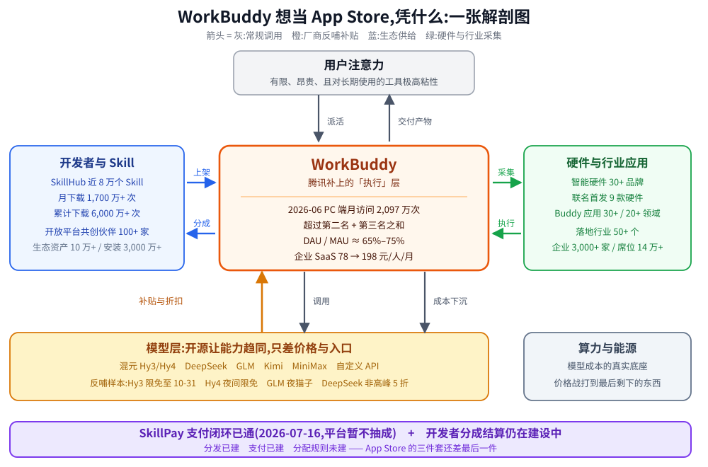

## 德说-第536期, AI 时代的平台生意模式出现了, 我似乎看懂了 WorkBuddy
  
### 作者  
digoal  
  
### 日期  
2026-10-12  
  
### 标签  
AI , LLM , Agent , 助手 , 平台 , APP Store , 生态 , WorkBuddy 
  
----  
  
## 背景 
AI 时代的平台生意模式出现了, 我似乎看懂了 WorkBuddy. 

为什么腾讯要重投 WorkBuddy? 我个人认为, 它想成为 AI 时代的苹果 APP Store.

当 WorkBuddy 成为第一 AI 助手流量入口. 

LLM 厂商会巴结 WorkBuddy, 偶尔搞搞送积分、降价活动. 用户的注意力是有限的, 对于长期使用的工具, 粘性极高. 市面上的 Agent 一定会收敛, 向头部几个集中. 自己做 Agent 的 LLM 厂商, 最终可能是出力不讨好的. 而且由于开源 LLM 的存在, 未来 LLM 卷的就是价格, 最终成本在算力和能源上. LLM 厂商不巴结这些头部 Agent, 就很难获客.  

各种开源的 plugin 会巴结 WorkBuddy. 例如我现在已经很少到 github 找 Agent 插件了, 因为 WorkBuddy 要成为第一流量入口, 自己肯定要做好体验, 它的 buildin 一定会做到 80 分以上, 例如生成 PPT 的 plugin, 我千辛万苦找的 plugin 还不如内置的. 不信你赶紧去试一试吧, 大量赚积分换 token 的任务, 相当于一直在免费用 WorkBuddy, 包括它接入的各种模型. 

所以我说 WorkBuddy 要做 AI 时代的 苹果 APP Store, 毫不夸张. 因为周边产品接入 WorkBuddy 就可以被用户使用, 就可以赚钱. 根本不用自己去做渠道, 无非就是把做渠道的营销费用给 WorkBuddy 分走一杯羹而已. 

你怎么看? 腾讯股票买起来?
  
---  
  
# 腾讯正在造 AI 时代的 App Store,而它手里最值钱的那块,恰恰还没建完

这个月你有没有发现,AI 助手的账单是 0 元,但你确确实实在用它干活。

签到送积分,跑完任务送积分,把猫派出去旅游回来送积分。学生和老师认证一下各送 1,000 积分。混元 Hy3 直接限免到 10 月 31 日,Hy4 preview 每天晚上 23 点到次日 8 点免费。GLM 给你"夜猫子"错峰折扣,DeepSeek 的旗舰模型在非高峰时段打五折。

你不觉得奇怪,因为你已经被养成了重度用户。但换个角度看这件事:厂商为什么不自己去拉客,要把补贴白白送给一个入口?

因为那个入口已经攒下了 **2,097 万次月访问量**(易观《2026 年 Q2 中国办公智能体平台市场洞察报告》,2026 年 6 月,PC 端口径),超过第二名和第三名加起来还要多 656 万次。DAU/MAU 稳定在 **65%–75%** 的区间——作为参照,Slack 巅峰期的日活月活比长期也就 65%–70%。

这个入口叫 **WorkBuddy**,腾讯云 CodeBuddy 团队做的全场景 AI 办公智能体桌面工作台,2026 年 3 月 9 日上线。

腾讯云副总裁、CodeBuddy 与 WorkBuddy 负责人刘毅在 9 月 2 日的生态发布会上把话说得很直白:

> 我们希望把 WorkBuddy 打造成面向 Agent 时代的操作系统——不是做一个更强的工具,而是做一个能承载所有工具的平台。

"承载所有工具"这五个字,就是 App Store 的中文翻译。

## 腾讯缺的那一层,叫"执行"

先说清楚为什么是腾讯,而不是别人。

回头看腾讯的产品史,它的核心思路一直是"连接":QQ 连人与人,微信连人与组织,微信支付连人与交易,小程序连人与服务,腾讯会议连人与企业。这条路腾讯走了二十多年,几乎没出过错。

但所有这些连接都停在"连接"这一层。它告诉你哪儿有服务,自己不替你干活。

AI Agent 时代不一样。用户不再问"附近哪儿有充电桩",而是"帮我把这件事办了"。这是一次从分发到执行的跃迁,而腾讯在这条路上是空白的。

于是有了 WorkBuddy。腾讯在办公侧的历史积累——企业微信、腾讯会议、腾讯文档、乐享、网盘——全部被接进这一个底座。9 月 23 日,腾讯文档、腾讯乐享、腾讯网盘、Ardot 首批接入企业版套件,一个订阅打通账号、积分、记忆与数据体系。官方的说法是 WorkBuddy 企业版承担 Agent Harness 的角色,给各个应用提供统一执行底座。

一个细节值得记下来:公开报道提到,某国内 SaaS 厂商在几天之内就完成了与 WorkBuddy 的对接。传统 To B 的对接周期以月计,现在是天。

另一组数据更能说明它落到实处的程度:蒙牛奶源事业部的员工把两本奶牛疾病权威著作"喂"进 WorkBuddy,再结合自己多年一线牧场经验封装成"奶牛精准诊疗智能 Skill",单牧场诊疗时效从 1.5 天压缩到 2 小时。深圳港的报关单填报,从 30 分钟压到 5 分钟。这类案例不是产品发布稿里的漂亮话,而是有人真的拿去用了。

## 第一层:模型厂商已经开始给这个入口发红包

一个流传很广的判断是"LLM 厂商会巴结 WorkBuddy"。这条推论不需要相信,可以直接查证——反哺的证据全摆在客户端里。

| 反哺动作 | 具体内容 | 截止时间 |
|---|---|---|
| 混元 Hy3 限时免费 | 自选模型中 Hy3 占比已超 60%,是当前主力 | 延期至 2026-10-31 |
| Hy4 preview 夜间限免 | 每晚 23:00–次日 8:00 闲时免费 | 延期至 2026-10-31 |
| GLM 夜猫子计划 | 每晚 23 点至次日 8 点使用享折扣 | 持续 |
| DeepSeek-V4-Pro 非高峰 5 折 | 工作日 09–12 点、14–18 点为原价 | 持续 |
| 每日签到 | "Buddy 加油站"每天 100 积分,连签 7/14/28 天有里程碑大奖 | 持续 |
| 开学季普惠 | 学生、教师认证各 1,000 积分 | 学生至 10-31,教师至 9-30 |

为什么模型厂商愿意这么做?两条原因,第一条是生意,第二条是结构。

生意上的原因很直白:获取一个深度使用中的办公 Agent 流量,比投广告便宜得多。用户在一个工具里每天干活,厂商只要把价格降下来,调用量就上去了。而降价的边际成本,落在推理的算力和能源上——这部分成本随着技术迭代在快速下行,模型厂商完全有能力承担。

结构上的原因才是关键: **开源让模型能力趋同了,剩下的差异只有价格和入口。**

当 Hy3、DeepSeek、GLM、Kimi、MiniMax 在客户端里像下拉菜单一样随意切换,用户凭什么为某一个模型付溢价?能力趋同之后,模型厂商失去了差异化,唯一还能打的牌就是"到哪儿去被用"。而一个日活占月活七成的桌面工作台,就是最短的那条路。

所以这条链路的正确表述不是"厂商巴结 WorkBuddy",而是: **WorkBuddy 掌握分发,所以它掌握议价权。**

顺带说一句,这个补贴量级已经大到需要认真对待。第三方(36 氪平台一篇署名实测稿,非官方口径)测算:WorkBuddy 标准版 70 元/月含 4,000 积分,按其实测的积分–Token 兑换率与 API 牌价折算,补贴倍数约 5.6 倍;对比同类产品约 2.2 倍。这还是用第三方模型的结果——如果平台用自家模型,价差会吃掉一部分补贴。

补贴不是慈善,是获客成本,只是换了个记法。

## 第二层:Skill 开始往这里搬家

第二个判断是"开源插件会巴结 WorkBuddy"。这条同样能查证。

SkillHub 是腾讯的 AI 技能社区。腾讯新闻 2026 年 7 月 16 日的官方口径:上线**两个多月,聚合近 8 万个 Skill,月下载量 1,700 万+ 次,累计突破 6,000 万+ 次**。开放平台(open.workbuddy.cn)首页今天挂的数字是: **10 万+ 生态资产、3,000 万+ 累计安装、100+ 家共创伙伴**。

这个体量意味着什么?意味着一个独立开发者把 Skill 放上去,理论上能触达一个比 GitHub 更容易变现的池子。GitHub 上的 Skill 生态至今没有官方的技能总数统计,技能散落在各个仓库里,要靠仓库搜索或 `gh skill search` 去发现;而 SkillHub 有分类、有下载热榜、有 TRACE 评测打分、有安装量排行。

这就是"我现在很少去 GitHub 找 Agent 插件了"的真实原因——不是懒,是**发现成本和信任成本被平台吃掉了**。第三方评测指出,WorkBuddy 在安装 Skill 前会做自动安全扫描,SkillHub 平台侧还有内容指纹、数字签名和五维质量评估。GitHub 给不了这个,因为 GitHub 不打算替你判断一个 Skill 安不安全。

这正好回答了一个关键问题: **为什么平台会主动帮开发者赚钱?**

因为分发和支付本身不赚钱,只有当第三方生态足够繁荣、足够不可替代,平台才收得到租。App Store 靠的不是卖 App,是 iOS 每年给它带来的硬件差价和服务抽成;同理,WorkBuddy 想收的不是 Skill 的钱,是所有依附在这个执行层上的生意的钱。

## 第三层:接入之后,渠道费变成了平台费

第三个判断最有意思:"周边产品接入 WorkBuddy 就能赚钱,根本不用自己做渠道,无非是把做渠道的营销费用分一杯羹给 WorkBuddy。"

看第一批入驻 SkillPay 的名单就更清楚了。2026 年 7 月 16 日,腾讯 SkillHub 上线 SkillPay——把技能分发、Agent 调用、技能支付打通在一条链路上,底层基于微信支付的 Agent Pay X402 协议。首批上架 Pay Skill 的包括:腾讯视频的 WorkRally(AI 漫剧与短剧生成)、通达信(专业行情)、腾讯自选股(智能选股)、携程(机酒预订)。

这几个例子有一个共同点: **它们本来都有自己的 App,都已经投了渠道费,都已经有品牌认知。**

那为什么还要把能力挂到 WorkBuddy 上?

因为获客成本模型变了。以前在一个 App 里做搜索导流,或者投信息流广告,按曝光计费;现在在 Agent 里,Agent 会根据用户对话自动判断该调谁。用户说"帮我查下这只票的走势再做个图",Agent 直接调用通达信的 Pay Skill,对话里弹出支付授权,0.08 元,确认,出结果,全程不跳出对话。

**用户不需要知道这个能力来自哪个 App。** 这才是渠道的本质——不是广告位,是不需要用户做选择的那一层。

平台在这里的角色就清楚了:它不出售注意力,它代售分发权。它把原本散落在几十个 App 里的能力,装进一个用户每天都会打开的对话框,然后对成交收一笔钱。

## 但冷静点:App Store 的三件套,腾讯只建了两件半

上面三段推论如果都成立,那 WorkBuddy 已经是 App Store 了。但把 App Store 的三件套拆开逐条对一遍,会发现最后一件还是空的。

| App Store 三件套 | WorkBuddy 现状 |
|---|---|
| **分发**:统一的发现、搜索、安装、评价 | ✅ SkillHub 近 8 万 Skill、月下载 1,700 万+;开放平台 100+ 共创伙伴 |
| **支付**:统一收银台、结算、退款 | ✅ SkillPay(2026-07-16),微信支付 AI 专属卡,对话内闭环 |
| **分配**:开发者拿走大头,平台抽成 | ⚠️ **这一块还没建完** |

第三件套的证据是明确的。腾讯云开发者社区上一篇 2026 年 9 月 20 日的亲历记录写得很清楚:开放平台刚上线,官方口径是"支付能力和分发通路正在加速建设",即使技能有安装量、有调用,**分成收益目前也不会到账**。那位作者两周上架 4 个技能,最好的一个是 43 次安装、40 次调用,他自己的结论是——现阶段拼的是占位和安装量。

更直接的证据在 SkillPay 的官方 FAQ 里。平台自己的回答是:

> Pay Skill 采用按次计费,单次价格由商家自主设定。支持微信支付与支付宝渠道,**平台暂不收取技术服务费**。

暂不抽成。这四个字是整篇文章里最关键的一个限定词。

对比一下 App Store:苹果的标准抽成是行业明规则,2021 年起还专门开了小企业计划,年营收 100 万美元以下的开发者享受 15% 的优惠费率(来源:Apple Developer 官方页面)。苹果的分歧从来不是"要不要抽",而是"抽多少、给谁免"。

腾讯现在连"要不要抽"都还没回答。

这不是一个批评,恰恰是这套商业模式的必经阶段——**没有任何平台能在开发者还没挣到钱之前先抽成。** 但它意味着,WorkBuddy 到今天为止还不是一个靠抽成运转的平台。它是一个在用补贴换供给、用补贴换用户的入口。

所以更准确的说法应该是: **WorkBuddy 正在长成 App Store,现在还差最后一节骨节——那个让开发者能安心靠它吃饭的分配规则。**

而这一节什么时候补上、怎么补,决定了这件事是"入口生意"还是"平台生意"。

## 这笔账最后是谁在付

还有一个必须算的问题:补贴的钱从哪来?

按第三方实测的兑换率倒推,WorkBuddy 高级版 140 元买 9,000 积分,单积分合一分六厘;而按市场算力价折算,单积分背后的真实成本在六分到二毛四之间——**倒挂五到十倍**。

这不是 WorkBuddy 一家的账。整个行业都在这么打。腾讯云首席战略官 James Mitchell 在二季度财报会上说,云业务收入增速从一季度接近 20% 加快到二季度 20% 出头,WorkBuddy 付费用户已产生正毛利,毛利率可与腾讯云整体媲美(2026 年二季度云业务毛利率 52%)。

**注意这个"正毛利"的措辞。** 正毛利的意思是:单个用户的订阅收入,已经能覆盖为他付出的推理成本。行业那句"2026 年模型成本一年下降约 80%",落到了财报的这一行里。

那补贴的部分呢?补贴不产生毛利,补贴是市场费用。汤道生说过一句被广泛引用的话——没给 Buddy 团队设商业化目标。刘炽平在财报会上的定性更直白:WorkBuddy 的主要目的是推动战略级应用的普及,并为模型与更广泛生态提供反馈循环, **产生收入是"令人高兴的效果"** 。

翻译一下:这个产品先按战略入口来投,不按生意来算账。腾讯赌的是入口归属,不是当期利润。

这个赌法能不能赢,取决于三件事——而这三件事都不在腾讯自己手里。

## 三个可以验证的指标

推论这东西,不能只讲得通,得能被证伪。以下三个指标在未来两到四个季度里会给出答案。

**第一,SkillHub 上有没有出现真实的、个人开发者的收入。**

现在 Pay Skill 的首批入驻全是企业和机构:腾讯视频、通达信、自选股、携程。个人通道还没开——目前要求企业认证并绑定微信支付商户号,个人发布功能显示"即将上线",可行路径是个体工商户或工作室主体入驻。

如果两三个季度之后,生态里出现了靠单个 Skill 月入几千块的独立开发者,那"开发者会巴结 WorkBuddy"这句推论就算被证实了。如果到那时仍然是清一色的企业服务在挂件、没有一个个人开发者靠技能赚到钱,那 WorkBuddy 就只是个企业集成平台,离 App Store 远得很。

**第二,平台什么时候开始抽成,以及抽多少。**

"暂不收取技术服务费"是一个有明确保质期的承诺。如果三年内都不收,那 WorkBuddy 永远不成立平台生意——它更像一个永远免费的企业集成层,对腾讯的价值在于云资源消耗和生态卡位,而不是交易抽成。

一旦开始抽,苹果式的第一个动作通常不是抽成,而是**降低门槛**:把 15% 之类的小微费率推到全体开发者,换取供给规模的爆发。目前生态里流传的"上传技能审核通过得 2,000 到 10,000 积分"这类说法,官方文档从头到尾没提过,客户端任务中心也根本没有这个条目——**在分配规则公开之前,任何奖励政策都不足信。**

**第三,补贴退坡之后,留存还剩多少。**

这批被"5.6 倍补贴"养出来的重度用户,对价格极其敏感。真正的检验不是现在——现在补贴充足,DAU/MAU 65%–75% 看着很漂亮——而是某次补贴到期之后。

腾讯云第三季度财报里 WorkBuddy 的活跃留存率和付费留存率,会是这张答卷上最诚实的一个数字。目前的公开口径是活跃用户留存超 60%、付费用户留存超 80%。

## 回到开头那个 0 元账单

现在回到那个 0 元账单。

如果你把它当成"腾讯在发福利",那你看到的是补贴。如果你把它当成"我在用一台别人正在补贴的机器,机器的持有者正在补贴所有供应商和所有开发者",那你看到的是议价权。

这才是腾讯重投 WorkBuddy 的真实动机:它不需要靠这个产品赚钱,它需要的是**让所有人都依赖这个入口**。

模型厂商依赖它来卖 Token,开发者依赖它来拿流量,企业依赖它来交付,硬件厂商依赖它来让设备"聪明起来"。这些依赖关系越深,WorkBuddy 就越接近那个位置——AI 时代的 App Store。

但也别急着下结论。App Store 之所以成为 App Store,靠的不是"承载所有工具"这句口号,而是三件具体的东西: **让开发者挣到钱的分配规则、让用户放心的安全与隐私机制、二十年不间断的迭代投入**。

第一件腾讯还在建,第二件做到了(信通院可信认证、高危操作二次确认、文件权限隔离),第三件正在做——官方在 9 月 2 日生态发布会上的说法是:从 3 月初上线到那天完成了 50 多个版本的迭代,节奏最快的时候是 3 月到 6 月的 43 个版本,平均不到两天一版。

三个月,50 个版本。这个节奏本身就是一种表态。

所以你现在的判断大概可以这样改一改: **WorkBuddy 已经是 AI 时代最像 App Store 的那个东西了,但它现在更像一个还在烧钱补贴、尚未公布分配规则的 App Store。**

真正决定它能不能坐稳那个位置的,不是又接入了多少伙伴,而是当补贴退下去的那一天,还有多少开发者愿意留在上面。

那一天会来。到那天再来看这张账单,你会知道自己当初是不是看对了。

---

## 数据来源与核实说明

| 数据点 | 来源 |
|---|---|
| 2026-06 PC 端月访问 2,097 万次,超二三名之和 | 易观《2026 年 Q2 中国办公智能体平台市场洞察报告》,2026-07-20 发布 |
| DAU/MAU 65%–75%、PC 端日活超 200 万 | 第三方机构统计,新浪财经 2026-07-28 |
| SkillHub 近 8 万 Skill、月下载 1,700 万+、累计 6,000 万+ | 腾讯新闻 2026-07-16/17 |
| 开放平台 10 万+ 生态资产、3,000 万+ 安装、100+ 共创伙伴 | open.workbuddy.cn 官网首页,2026-10-12 实查 |
| SkillPay 2026-07-16 上线、"平台暂不收取技术服务费" | skillhub.cloud.tencent.com/skillpay 官方 FAQ |
| 首批 Pay Skill:WorkRally、通达信、自选股、携程 | 腾讯新闻 2026-07-16 |
| 开发者分成结算未落地 | 腾讯云开发者社区 2026-09-20 亲历记录 |
| 企业 SaaS 78 → 198 元/人/月 | 腾讯云计费方案调整公告,2026 年 4 月底(另有媒体口径称 5 月 15 日,两个日期未统一) |
| 活跃留存 >60%、付费留存 >80% | 腾讯 2026 年一季度财报口径 |
| Q2 云毛利率 52%,WorkBuddy 付费用户已正毛利 | 腾讯 2026 年二季度财报电话会,James Mitchell |
| 刘毅"面向 Agent 时代的操作系统" | 腾讯生态发布会,2026-09-02,科技日报 / aibase 报道 |
| 刘炽平"产生收入是令人高兴的效果" | 腾讯 2026 年二季度财报电话会,媒体转述 |
| 蒙牛奶源 1.5 天 → 2 小时、深圳港 30 分钟 → 5 分钟 | 腾讯云公开案例 |
| Hy3 限免至 10-31、Hy4 夜间限免 | 和讯网 2026-09-30;客户端模型列表实查 |
| 苹果小企业计划 15% 费率(年营收 100 万美元以下) | Apple Developer 官网 developer.apple.com/app-store/small-business-program |
| 补贴倍数 5.6 倍 / 2.2 倍、积分倒挂 5–10 倍 | 36 氪平台署名实测稿,2026 年 10 月。 **第三方个人实测推算,非官方口径,仅作量级参考** |

## 诚实清单

- **本文所有 WorkBuddy 数据均为公开资料整理,作者未注册、未实测该产品。** 补贴倍数、积分–Token 兑换率、倒挂倍数三项来自第三方个人实测推算,不是官方口径,存在系统性误差可能,只作量级参考。
- **未查到开发者分成比例。** SkillPay 官方 FAQ 明确"平台暂不收取技术服务费",但没有给出未来的抽成比例表。目前"分成结算通路正在加速建设"是官方原话,具体规则未公开。
- **Skill 数量存在口径差异。** 官方口径为"近 8 万个 Skill"(腾讯新闻 2026-07);个别自媒体提到"76 万+",未找到官方来源佐证,本文采用官方口径。同理,开放平台首页的"10 万+ 生态资产"与 SkillHub 的"8 万+ Skill"是两个不同口径的指标,不可直接相加或比较。
- **"DAU/MAU 65%–75%"来自第三方机构统计**,非腾讯官方财报披露数字,与财报口径的"活跃留存超 60%"不是同一个指标,不要混用。
- **企业版提价日期有两个版本**(4 月底公告 / 5 月 15 日媒体口径),本文以"2026 年 4 月底"为准并标注差异。
- **蒙牛、深圳港等落地案例均为企业侧公开口径**,未经第三方独立验证。有一份面向 WorkBuddy 的第三方评测(70 题,覆盖 Word/Excel/PPT/浏览器/代码/深度研究/设计七个方向)平均得分 2.31/4,Word 2.85,设计类仅 1.45 —— **这说明它的短板在审美与复杂判断,而这类短板恰恰是第三方 Skill 的生存空间**,本文未展开。
- **本文未点名同类竞品**,涉及对比处统一以"同类产品""某软件厂商"指代。
  
  
  
#### [PostgreSQL 解决方案集合](../201706/20170601_02.md "40cff096e9ed7122c512b35d8561d9c8")
  
  
#### [德哥 / digoal's Github - 公益是一辈子的事.](https://github.com/digoal/blog/blob/master/README.md "22709685feb7cab07d30f30387f0a9ae")
  
  
#### [About 德哥](https://github.com/digoal/blog/blob/master/me/readme.md "a37735981e7704886ffd590565582dd0")
  
  

  
