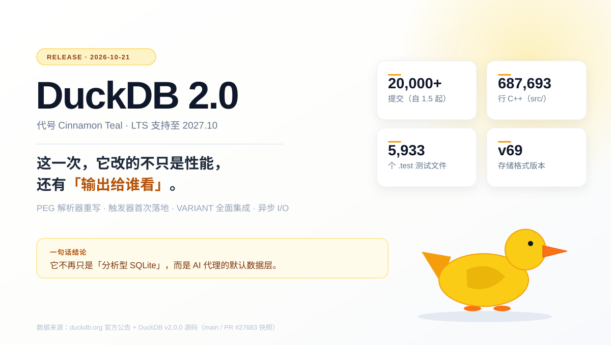
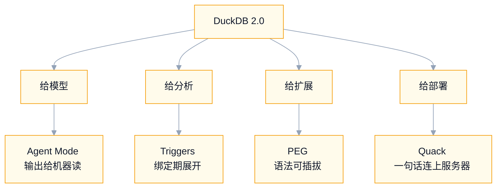
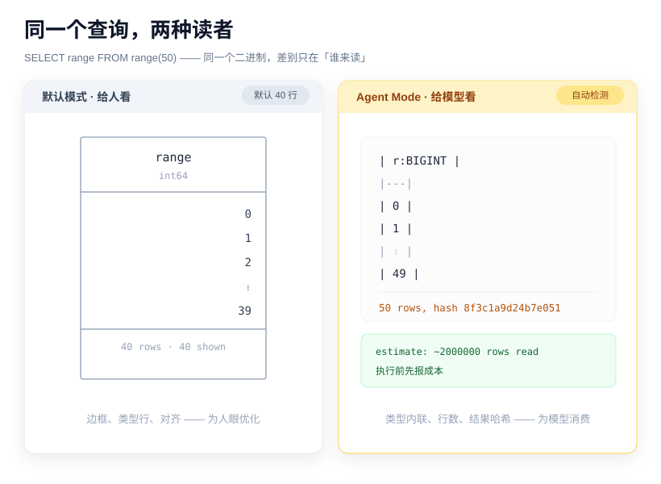
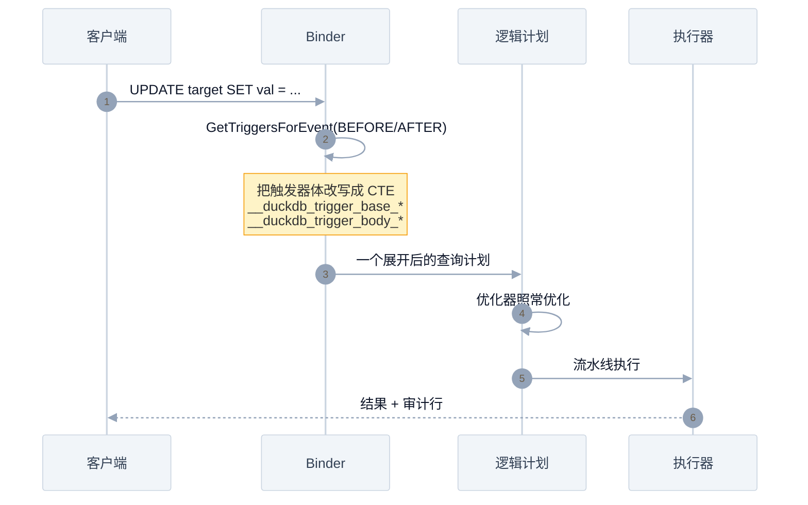
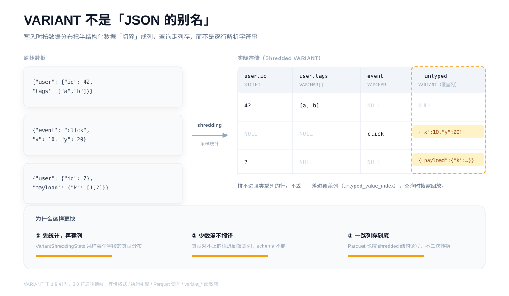
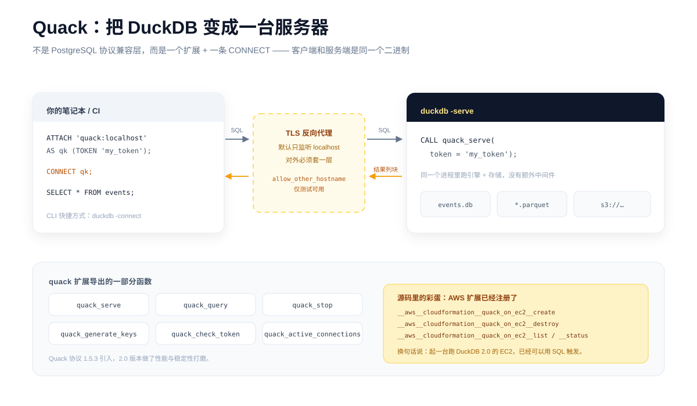
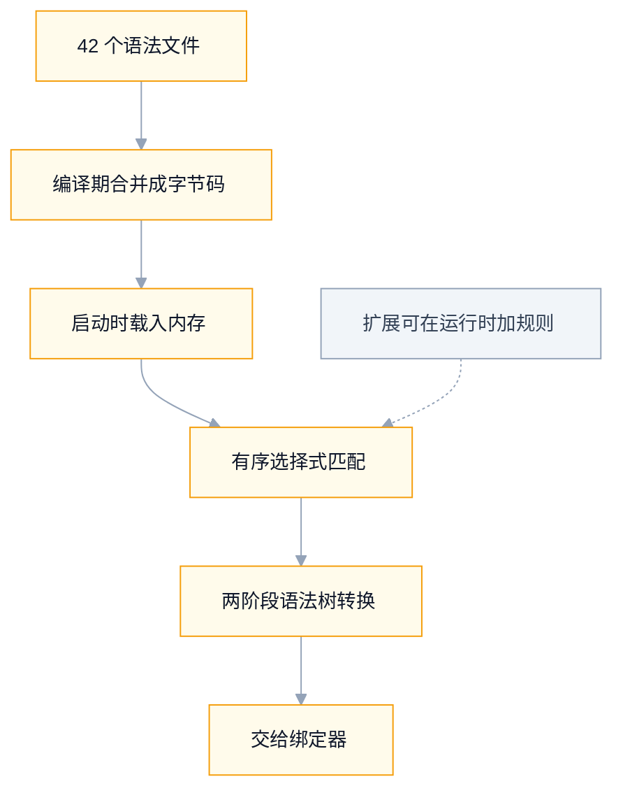

## DuckDB 2.0 源码拆解：一个数据库，开始为 AI 重写自己
  
### 作者  
digoal  
  
### 日期  
2026-10-23  
  
### 标签  
AI , Agent , DuckDB  
  
----  
  
## 背景 

> 20,000 次提交、5 处真正的结构改动、1 个不能回退的坑。
> 我把官方公告和 v2.0.0 源码对着读了一遍。这篇只讲代码里能验证的部分。



---

## 先说一个你大概遇到过的场景

你让 AI 助手查一下某个 Parquet 文件里 3 月的订单量。它调用 `duckdb -c "..."`，回车。

屏幕上刷出 40 行带边框的字符画：

```text
┌──────────┬─────────────┐
│  month   │ order_count │
│ varchar  │    int64    │
├──────────┼─────────────┤
│ 2026-03  │       18432 │
│ 2026-03  │        9921 │
│   ...    │         ... │
└──────────┴─────────────┘
40 rows · 40 shown
```

模型把这坨东西吞进上下文，然后在里面找数字。

一份 50 行的结果，被渲染成 50 行边框加表头加类型行——token 花掉了，信息密度却低得可怜。更麻烦的是出错的时候：报错是一段给人看的话，外加 `LINE 1: ... ^^^` 这样的箭头，模型只能靠猜。

**这就是 DuckDB 2.0 第一个改动的起点。**

不是性能，不是新语法，是「谁来读这个输出」。

---

## 一、先把事实摆上桌

2026 年 10 月 21 日，DuckDB 发布 **2.0.0 LTS**，代号 Cinnamon Teal（桂红鸭），LTS 支持到至少 2027 年 10 月。

几个能查证的硬指标：

| 指标 | 数值 | 出处 |
|---|---|---|
| 自 1.5 以来的提交数 | 约 20,000 | 官方公告 |
| `src/` 下 C++ 代码 | 687,693 行 | 源码统计 |
| `.test` 测试文件 | 5,933 个 | 源码统计 |
| 存储格式版本 | 68 → **69** | `storage_info.hpp` |
| 序列化版本 | 7 → **8** | `storage_info.hpp` |
| 编译器要求 | C++17（低于 17 直接编译报错） | `CMakeLists.txt` |

这些数字里，真正重要的是最后两行。

**存储格式从 68 跳到 69，意味着 2.0 写出来的数据库文件，1.5 及更早版本读不了。** 反过来可以：2.0 能读写旧文件，旧文件也仍然能被旧版本读。

这是 2.0 唯一一个「升上去就回不来」的地方。后面会专门讲。

那 20,000 次提交换来了什么？我的判断是： **五条主线，每条都指向同一个方向——让 DuckDB 从「分析型 SQLite」变成「AI 的数据执行层」。**



下面一条条拆。

---

## 二、狠招一：为「读输出的那个模型」重做终端

DuckDB 2.0 的 CLI 里藏了一个叫 **Agent Mode** 的东西。

它不靠配置文件开启，而是**从环境变量里认人**。源码的测试文件 `tools/shell/tests/test_agent_mode.py` 里，把这些标记一个个列了出来：

```python
@pytest.mark.parametrize("agent_var,agent_value", [
    ("AI_AGENT", "claude-code_2-1-282_agent"),
    ("AGENT", "amp"),
    ("CLAUDECODE", "1"),
    ("CODEX_CI", "1"),
    ("CURSOR_AGENT", "1"),
    ("GEMINI_CLI", "1"),
    ("COPILOT_AGENT", "1"),
])
def test_detect_agent(shell):
    ...
```

只要命中其中一个，并且 stdout 不是终端（说明输出被管道接走了），模式自动切换。

切换之后，同一个查询的输出变成这样：



差别不只是「紧凑一点」。把测试用例读完，会发现每个细节都冲着「模型怎么消费」去设计：

**1. 类型直接写进表头**

```text
| r:BIGINT |
|---|
| 0 |
| 1 |
```

传统输出里，类型单独占一行 `int64`；现在它和列名合成 `r:BIGINT`。少一行，信息一点没丢。

**2. 结果封顶，但封得很聪明**

- 1000 行 / 10000 字节以内：整份渲染
- 超了：只给**首 20 行 + 尾 20 行**，中间插一行 `| … 2460 rows omitted … |`
- 单元格超过 500 字符：截断并标注 `é\|…(+100 chars)`

关键在于它**不说谎**。被截断了就明确写「省略了多少行」，而不是像很多工具那样悄悄截断。

**3. 给一个结果哈希**

```text
50 rows, hash 8f3c1a9d24b7e051
```

这个 16 位十六进制哈希是**与顺序无关**的：`ORDER BY r` 和 `ORDER BY r DESC` 出来的哈希一样，少一行就变。模型可以用它判断「两次查询结果是否真的相同」，不用逐行比对。

**4. 报错变成 JSON**

```json
{"exception_type":"Binder",
 "exception_message":"Referenced column \"foo\" not found in FROM clause!",
 "position":"7"}
```

`LINE 1:` 和 `^^^` 那套给人看的排版全部去掉。模型解析 `exception_type` 就知道该重试还是该改 SQL。

**5. 先报成本，再干活**

大查询执行前，stderr 会先出一行：

```text
estimate: ~2000020 rows read (t ~2000000, range ~10), ~1 rows returned
```

模型据此决定「值不值得等」。

**6. 失控的查询自己停**

结果超过上限后，只统计和哈希一段时间就主动终止，输出 `first 20 of at least N rows (query stopped early)`。这一点对 Agent 特别重要——没人希望 AI 随手 `SELECT *` 把上下文撑爆。

官方给的数字是：TPC-H 实验里，模型需要阅读的输出减少了 **59%** 。

> **我的判断：** 这不是「加了个输出格式选项」。这是第一次有数据库把「读者不是人」写进了产品设计——从环境变量识别、到截断策略、到错误结构，一整套。其他数据库抄得走 UI，抄不走这个思路。

想手动试：`duckdb -agent` 开启，`-no-agent` 关闭，或者 `DUCKDB_AGENT_MODE=1/0`。

---

## 三、狠招二：触发器，以及一个很「DuckDB」的实现方式

DuckDB 这么多年一直没有触发器。2.0 补上了——`CREATE TRIGGER`，支持 BEFORE / AFTER、FOR EACH ROW / FOR EACH STATEMENT、过渡表 `REFERENCING OLD/NEW TABLE`，还能在被触发表上用 `RETURNING`。

典型写法，维护一张审计表：

```sql
CREATE TRIGGER trg_audit
    AFTER UPDATE ON target
    REFERENCING OLD TABLE AS o NEW TABLE AS n
    FOR EACH STATEMENT
        INSERT INTO audit
        SELECT n.id, o.val, n.val FROM o JOIN n ON o.id = n.id;
```

但真正值得看的不是语法，是**它是怎么实现的**。

大多数数据库（比如 PostgreSQL）走的是运行时路径：有一张触发器注册表，每次 DML 到了执行器，再去查表、调函数、跑触发器体。

DuckDB 没这么干。它把触发器**在 Binder 阶段就展开成了查询计划的一部分**。

打开 `src/planner/binder/query_node/bind_trigger_expansion.cpp`，你会看到这样的常量：

```cpp
static constexpr const char *TRIGGER_BASE_CTE_PREFIX = "__duckdb_trigger_base_";
static constexpr const char *TRIGGER_BODY_CTE_PREFIX = "__duckdb_trigger_body_";
static constexpr const char *TRIGGER_BEFORE_BODY_CTE_PREFIX = "__duckdb_trigger_before_body_";
```

也就是说： **触发器体被改写成 CTE，直接拼进原查询。** 主入口 `Binder::TryExpandTriggers()` 拿到的是一棵 `QueryNode`，返回的是一棵被展开过的计划。

流程长这样：



这个选择带来两个后果，一好一坏。

**好的那边：** 触发器不再是「执行器里的黑盒」。它变成了计划节点，优化器能对整棵树做谓词下推、列裁剪；`EXPLAIN` 能看见它；没有触发器时，这条路径直接 `return nullptr`，零开销。

**坏的这边：** 递归触发器链暂时不支持。源码里写得很直白：

```cpp
throw NotImplementedException(
    "Recursive trigger chains are not yet supported (trigger cycle detected "
    "through trigger %s on table %s)", ...);
```

官方说明里也列了一条限制：`BEFORE ... FOR EACH ROW` 和 `UPDATE ... FOR EACH ROW` 的组合还不支持。

还有个细节，我读的时候停了一下——`__duckdb_old_col_` 这组内部列名，在生成时会**不断加下划线**，直到它不是任何真实列名的前缀：

```cpp
while (collides) {
    // 如果和用户列名撞了，就再补一个下划线
    prefix += "_";
}
```

因为一旦撞名，OLD 别名会静默读到 NEW 的值——这种 bug 最难查。作者选择用「拼接直到不冲突」把可能性焊死。

> **我的判断：** 这就是 DuckDB 的工程风格——宁可多写三十行防撞名逻辑，也不在生产路径上留一个「运行时查表」的钩子。代价是功能上限（递归触发器做不了），收益是性能可预测。

`test/sql/trigger/` 下已经有 30 个测试文件，WAL、临时表、ALTER TABLE、BEFORE/AFTER 混用都覆盖了。不是半成品。

---

## 四、狠招三：VARIANT 不是「JSON 的别名」

上一版（1.5）引入了 `VARIANT` 类型，2.0 把它彻底打通了：存储、执行、Parquet 读写、`variant_*` 函数族，一条链路全通。

很多人看到 `VARIANT` 会想：哦，就是存 JSON 嘛。

**不是。**

`JSON` 类型本质是带校验的字符串。你查 `payload.user.id`，引擎得逐行解析 JSON 文本，再取值、再比较。数据量一大，这就是纯 CPU 消耗。

`VARIANT` 是**二进制编码 + 列式切分（shredding）** 。它在写入时先采样统计，判断每个字段「大概率是什么类型」，然后把这些字段拆成真正的强类型列。



源码里，这套统计逻辑在 `src/function/variant/variant_shredding.cpp` 和它的头文件里。核心结构叫 `VariantColumnStatsData`：

```cpp
//! Count of each variant type encountered
idx_t type_counts[static_cast<uint8_t>(VariantLogicalType::ENUM_SIZE)] = {0};
uint32_t decimal_width;
uint32_t decimal_scale;
bool decimal_consistent = false;
```

它统计每个字段出现的每一种 `VariantLogicalType`（BOOLEAN / BIGINT / DECIMAL / VARCHAR / GEOMETRY / BIGNUM …），连 DECIMAL 的精度和小数位是否一致都要管——因为精度不一致就没法合并成一列。

然后 `VariantShreddingStats::GetShreddedType()` 吐出推断出来的列类型。

**最关键的一点：推断必然会错。** 采样时 99% 的 `user.id` 是整数，第 10001 行突然来个字符串怎么办？

DuckDB 的答案是「覆盖列」（overlay column）。头文件注释写得很清楚：

```cpp
//! If force_partial is set, every level keeps its 'untyped_value_index' (overlay) column
//! even when the sampled values are fully consistent - allowing later inconsistent
//! values to be partially shredded.
```

拼不进强类型列的行，不丢，落进 `untyped_value_index`。schema 不会因为一条脏数据崩掉，查询时再按需回放。

> **我的判断：** 这个设计的价值不在「省空间」，在「schema 会漂移但查询要快」。日志、埋点、SaaS 导出、第三方 API 返回——这些数据的共同点是：字段大部分稳定，少数派天天变。旧做法要么全塞 JSON（查询慢），要么手工建宽表（维护地狱）。VARIANT 是第三条路。

---

## 五、狠招四：Quack——DuckDB 自己当了服务器

以前想让团队共享一个 DuckDB，路只有两条：套一层 PostgreSQL 兼容协议，或者自己写个服务把查询包起来。

2.0 给了第三条： **Quack 协议 + `CONNECT` 语句**。

三个扩展函数是核心：`quack_serve`（起服务）、`quack_query`（发查询）、`quack_stop`（停）。`extension_entries.hpp` 里还注册了一整套周边：`quack_active_connections`、`quack_check_token`、`quack_generate_keys`、`quack_cancel`、`quack_server_list`、`quack_uri_parser`……

服务端一行：

```sql
CALL quack_serve(token = 'my_token');
```

客户端三行：

```sql
ATTACH 'quack:localhost' AS qk (TOKEN 'my_token');
CONNECT qk;
SELECT * FROM events;
```



`CONNECT` 是 2.0 新增的语句，语法在 `src/parser/peg/grammar/statements/connect.gram` 里，一共五行：

```text
ConnectStatement <- 'CONNECT' SessionTarget?
DisconnectStatement <- 'DISCONNECT'
SessionTarget <- LocalSessionTarget / StringSessionTarget / CatalogSessionTarget
LocalSessionTarget <- 'LOCAL'
StringSessionTarget <- StringLiteral GenericCopyOptionList?
```

它不只能连 Quack。 **PostgreSQL、MySQL 也走这条语句**，配合远程下推优化器，把查询直接下发到远端执行，而不是把整张表拉回来。

CLI 还留了两个快捷方式：`duckdb -serve` 和 `duckdb -connect`。

安全上，官方说得很克制：默认只监听 `localhost`；要对外必须放在做 TLS 终止的反向代理后面；`allow_other_hostname` 只给测试用。

> **顺手挖到一个公告里没写的：** `extension_entries.hpp` 里有这么几行——
>
> ```text
> __aws__cloudformation__quack_on_ec2__create
> __aws__cloudformation__quack_on_ec2__destroy
> __aws__cloudformation__quack_on_ec2__list
> __aws__cloudformation__quack_on_ec2__status
> ```
>
> 意思是： **起一台跑 DuckDB 2.0 的 EC2，已经可以用 SQL 触发。** 函数已经注册，至于什么时候正式放开、怎么授权，公告没提——但这方向已经很清楚了。

---

## 六、狠招五：把解析器换了，顺便把语法开放出去

这件事影响没那么直观，但可能最深远。

DuckDB 从 2018 年起用的是基于 PostgreSQL 的 YACC/Bison 解析器（LALR(1)）。2.0 换成了 **PEG（Parsing Expression Grammar）解析器**，并且设为默认。

规模：`src/parser/peg/` 下 **42 个 `.gram` 语法文件**，C++ 部分 **47,345 行**。

整条链路是这样的——注意最右边那条虚线，它是这次换解析器真正的野心所在：



为什么值得换？三个理由：

**1. 没有语法冲突**

YACC 这类 LALR 解析器最怕 shift/reduce 冲突，加一条语法要反复调优先级。PEG 用**有序选择**（`/`），按书写顺序试，第一个匹配就赢——没有歧义，也就没有冲突。Python 3.9 换 PEG 是同一个原因。

**2. 错误提示能指到具体位置**

官方公告提到新解析器的错误消息带精确源码位置。对写 SQL 的人来说，这比性能提升更有感。

**3. 扩展可以改语法本身**

这是最狠的一条。`GrammarExtension` 允许扩展在**运行时**往语法里加规则：

```cpp
GrammarChange::AddChoice("UnreservedKeyword", "'ANSWER'")     // 加关键字
GrammarChange::PrependChoice("SelectAtom", "PipeSelectAtom")  // 给 SELECT 加新形式
```

装好之后，用户 `SET active_grammar_extensions = ['pipe_query_syntax']` 就能用管道语法：

```text
FROM tbl |> WHERE x > 10 |> SELECT a, b
```

还有 `DialectExtension`——可以注册一整套方言，连 tokenizer 都能换。`SET current_dialect = 'name'` 切过去。

> **我的判断：** 这一步是在把「SQL 方言」从核心团队的权力，下放给扩展作者。以前你想让 DuckDB 认识自家 DSL，只能 fork。现在写个扩展就行。

顺便，Parquet 读取换成了异步 I/O。`extension/parquet/include/parquet_reader.hpp` 里的接口已经变成 `AsyncResult` 这一套：

```cpp
AsyncResult ScheduleIO(...);
AsyncResult ScheduleRowGroupReads(ParquetReaderScanState &state, ParquetPrefetchStrategy strategy);
```

后台发起读取、多个请求同时在途——这对 `s3://` 上那些「延迟高、带宽足」的场景是决定性的。

---

## 七、代价：这次升级真的不能随便回退

前面都是好处，这节说坑。 **这一节建议直接收藏。**

### 坑 1：存储格式单向门

```cpp
V1_5_6 = 68,
V2_0_0 = 69,
```

2.0 默认写 69 版格式。 **旧版本读不了新文件。**

如果你的数据要交给还在跑 1.x 的同事、CI、或者线上服务，升级前必须想清楚。规避办法：用 Parquet 当中转（Parquet 格式不受影响），或者干脆一起升。

### 坑 2：Lambda 单箭头默认关闭

以前 `list_transform(l, x -> x + 1)` 能跑。2.0 里默认不行了。

源码里的枚举说得很清楚：

```cpp
enum class LambdaSyntax : uint8_t {
    DEFAULT = 0, ENABLE_SINGLE_ARROW = 1, DISABLE_SINGLE_ARROW = 2
};
```

要兼容旧代码，临时开一下：

```sql
SET lambda_syntax = 'enable_single_arrow';
```

**这个开关只活到 2.1。** 长期还是得改成 `lambda x : x + 1`。

### 坑 3：ICU 被整个移除了

时区、日历、排序规则以前由 ICU 库驱动。2.0 把 ICU 从核心里拿掉，改由 `icu` 扩展自己实现，时区数据直接构建自 IANA 数据库，压到约 45 kB。

行为不变，但**如果你的部署环境依赖内置的 ICU，现在需要显式装 `icu` 扩展**。

### 坑 4：编译门槛提高

- 要求 **C++17**（低于 17 直接报错，不是警告）
- 官方构建默认编译器换成 **Clang**
- macOS x86_64（`osx_amd64`）进入淘汰流程，**2.1 停止支持**
- Amalgamation 构建方式弃用

自己编译扩展、或者维护下游发行版的团队，这四条都要过一遍。

### 迁移检查清单

| 检查项 | 动作 |
|---|---|
| 数据文件要给旧版读？ | 先导出 Parquet，或整体一起升级 |
| 用了 `x -> x + 1` | 改 `lambda x : x + 1`，或临时 `SET lambda_syntax` |
| 依赖内置 ICU 行为 | 显式 `INSTALL icu; LOAD icu;` |
| 自编译扩展 | 按 C++17 重编，注意 Clang 下的警告 |
| 跑在 Intel Mac | 规划迁移到 arm64 / Linux |
| 生产关键负载 | 等 11 月首个补丁版，先在影子库跑 |

---

## 八、最后：三个信号，一个判断

把 2.0 的改动摊开看，有一条线很清楚。

**信号一：Agent Mode。** 一个数据库开始为「非人类的读者」优化输出格式——识别环境变量、控制 token 预算、给结果哈希、把错误结构化。这在数据库历史上是头一回。

**信号二：VARIANT。** 半结构化数据不再是「存成字符串，查的时候解析」。它变成了一等公民：有类型、有列存、有 Parquet 原生读写。

**信号三：Quack。** 从「一个进程里的库」变成「能对外提供服务的节点」，而且不需要中间件、不需要协议转换。

这三件事指向同一个位置： **AI 应用和它的数据之间的那一层。**

不是数据仓库（那层太重，AI 只需要一次查询）；也不是 SQLite（那层太弱，扛不住 Parquet 和列存）。是中间那个位置： **能直接读对象存储、能处理半结构化、能被一个 prompt 直接驱动**。

DuckDB 2.0 干的事，就是把自己挪到那个位置上。

至于要不要现在升——我的建议是：

- **个人 / 小团队 / AI 工作流**：升。Agent Mode 省下来的 token 和心智，比什么都值。
- **生产分析平台**：等 11 月补丁版，先在影子库验证存储格式那一关。
- **还在写扩展的人**：该看 PEG 了。语法可插拔这件事，会改变扩展的写法。

最后留一个问题：

当数据库开始为模型优化输出、为模型降低 token 成本、为模型把错误变成 JSON——**下一个被「为 AI 重写」的基础设施，会是谁？**

    
  
#### [PostgreSQL 解决方案集合](../201706/20170601_02.md "40cff096e9ed7122c512b35d8561d9c8")
  
  
#### [德哥 / digoal's Github - 公益是一辈子的事.](https://github.com/digoal/blog/blob/master/README.md "22709685feb7cab07d30f30387f0a9ae")
  
  
#### [About 德哥](https://github.com/digoal/blog/blob/master/me/readme.md "a37735981e7704886ffd590565582dd0")
  
  

  
