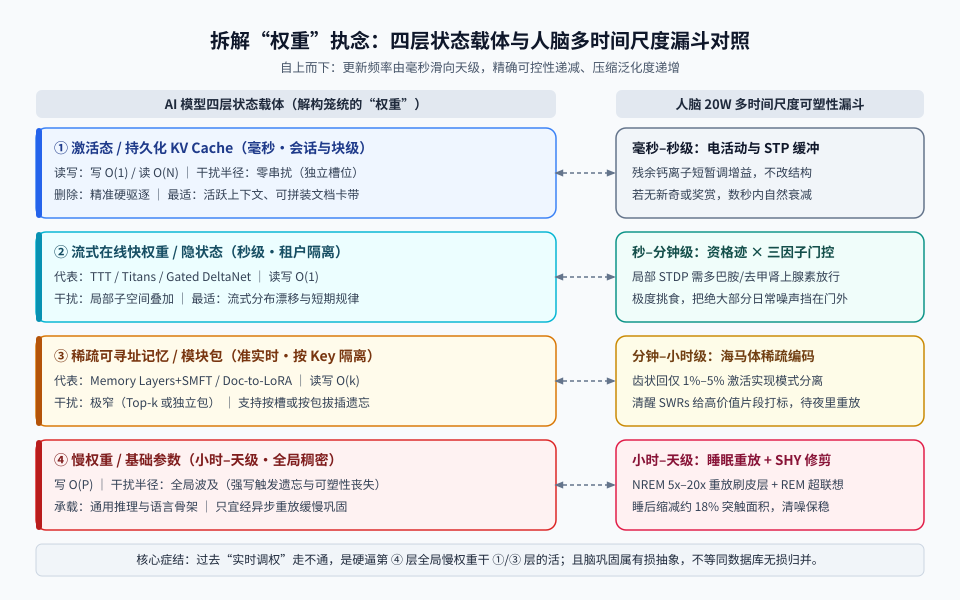
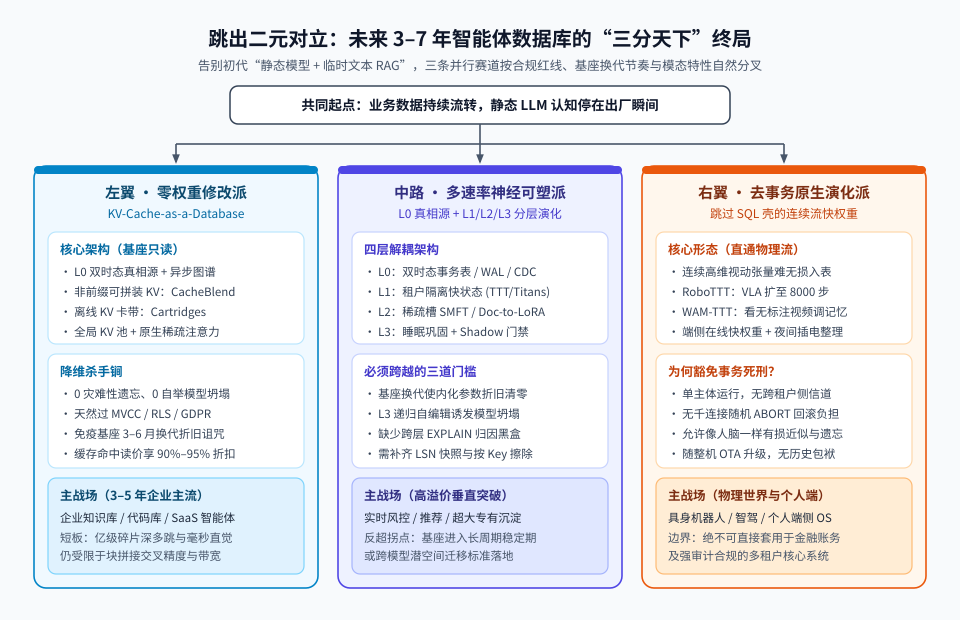

## 数据库能靠“实时调权重”活成智能体吗？  
  
### 作者  
digoal  
  
### 日期  
2026-11-27  
  
### 标签  
AI , Agent , 数据库 , Transformer , 权重 , 实时 , 快系统 , 慢系统  
  
----  
  
## 背景  
我是digoal德哥，Agent 本体 (agent-body) 项目创始人。  
  
之前我有提过一个对未来的断言“数据库内部应该有一种模型是能根据数据进出实时调权重的，这样数据库才能升级成实时的智能体”，而不是现在静态 llm + 数据库中提取 context 的协作模式。但这种实时模式有个技术壁垒没有突破，权重只是现在模型的说法，无法实时调也是现有 transformer 的技术所致的局限性。未来需要突破技术瓶颈，类似于人脑神经元一样可实时调，或准实时整理大脑神经元。  
  
今天咱们来聊聊这事，到底有什么技术瓶颈要突破。  
  
你对“静态 LLM + 数据库现场捞 Context”的不满，正踩在当下 AI 架构最软的肋骨上：业务数据日夜奔流，模型认知却冻在出厂瞬间，每次提问都得翻旧账、从零重算，活像一台健忘的计算器。  
  
更敏锐的是，你随口点出的“权重只是现有模型的说法”和“或准实时整理大脑神经元”，其实已经摸到了答案的门把手。但有一个直觉需要拆开重装： **卡死“实时调权重”的远不止 Transformer 一家；连我们想抄作业的人脑自己，其实也没选“来一条数据就改全脑权重”这条路。**  
  
## 一、别只怪 Transformer：真正锁死实时调权的四堵暗墙  
  
把锅全扣给 Transformer，其实是太客气了。Transformer 只背了显性接口层的小头——标准 Softmax 注意力把历史堆进线性膨胀的 KV Cache，带来 `O(N²)` 开销，逼得工程界把长期记忆赶到库外；前向传播又对前馈网络只读，天生没留写入通道。  
  
即便明天把 Transformer 全换成纯 MLP、RNN 或 Mamba，只要底层深度学习范式不变，往主干权重里实时写数据依然会崩盘。真正的大头，死锁在四堵暗墙里：  
  
- **稠密表征的全局干扰半径**。数据库按主键隔离，改张三碰不到李四；稠密网络却把知识叠压在共享矩阵里，一条新事实的梯度会沿共享子空间波及海量旧记忆。UC Berkeley 在 Findings of ACL 2024 证实，对 ROME、MEMIT 连续编辑终会从渐进遗忘滑向灾难性坍塌；Meta FAIR 与 UC Berkeley 的 [Sparse Memory Finetuning（SMFT）](https://arxiv.org/abs/2510.15103) 在 NaturalQuestions 上实测更直白——吸收同等新事实后，全参微调致旧知识 F1 **相对下跌 89%** ，LoRA **相对下跌 71%** ，仅更新极少数高相关稀疏槽才压回 **11%** （ICLR 2025 的 AlphaEdit 也通过零空间投影印证了正交隔离铁律）。  
- **全局反向传播的更新锁定**。Hinton 早指出反向传播受制于 Update Locking（须跑完前向并缓存全图激活方能回传）；数据库单条异构写入违背独立同分布假设，高方差梯度直推参数，无异于拿大锤修手表。  
- **混合精度优化器的 8 倍显存墙**。按微软 ZeRO 核算，FP16 推理仅需 2 bytes/param，而混合精度 Adam 静态状态就吞掉 16 bytes/param（2 字节权重、2 字节梯度加 12 字节 FP32 主副本与动量），尚未计入激活显存。高频写入一碰二阶矩，HBM 带宽即刻锁死。  
- **不只是忘旧，更是学不动新（可塑性丧失）** 。Dohare 与 Richard Sutton 团队在 [*Nature*（2024）](https://doi.org/10.1038/s41586-024-07711-7) 证明，持续梯度下降会让深网系统性僵化：ImageNet 连续二分类跑至第 2,000 任务时，准确率从约 **89%** 跌至约 **77%** （退化至浅层线性水平），须靠 Continual Backpropagation 定期重置低效用单元“续命”。纯梯度下降缺乏突触新陈代谢（宽语料、低速时间增量续训虽可借高秩 LoRA 缓解遗忘，但高频异构数据库事务流不享受此条件）。  
  
当然，壁垒并非铁板一块——把新知识编进权重，未必非撞反向传播与 8 倍显存墙。Sakana AI 的 Text-to-LoRA（ICML 2025）与 [Doc-to-LoRA](https://arxiv.org/abs/2602.15902)（2026 年 2 月）亮出了前向摊销超网络的新牌：在亚秒级单次前向里零反传、零优化器显存地把整篇长文档编译为独立低秩包（显存压进 50MB 内，泛化超原生窗口 4 倍以上）。删文档只需卸载对应包，既不伤全局也不串租户。  
  
这恰恰印证了你那句“权重只是现有模型的说法”。Google Research 在 NeurIPS 2025 的 [Nested Learning](https://arxiv.org/abs/2512.24695) 把架构与优化器统合进了同一框架——它们本质都是嵌套在不同时间尺度上的关联记忆。拆开笼统的“权重”，面前是四层载体：  
  
1. **激活态 / KV Cache**：写 `O(1)`、读 `O(N)`，独立槽零串扰、可精准驱逐，但显存随长度膨胀；  
2. **流式在线快权重 / 隐状态**：读写 `O(1)`，前向单步吸收流式漂移——从 Schmidhuber 1992 年快权重，经 DeltaNet、ICLR 2025 Gated DeltaNet，到 TTT 与 2025 年底的 TTT-E2E（3B 规模下 128K 损失持平全注意力且延迟恒定、快 **2.7 倍**），再到 Google 凭惊奇度动量把 NIAH 推过 200 万 Token、在极端长上下文多跳基准 BABILong 上超越 GPT-4 与 Llama 3 70B 的 Titans，均已打通前向可求导隐状态，只是本质仍为定容有损压缩器；  
3. **稀疏可寻址记忆层 / 独立参数包**：读写 `O(k)`，切碎干扰半径——Meta FAIR 的 Memory Layers at Scale 已扩至 1,280 亿参数（1 万亿 Token 预训练），解耦容量与算力，配 SMFT 或 Doc-to-LoRA 可按 Key 拔插；  
4. **全局稠密慢权重**：写 `O(P)`、干扰波及全网，只适合沉淀语言语法与通用推理骨架。  
  
  
  
症结一目了然：过去走不通，是因为硬逼着第四层慢权重去干第一层快缓存和第三层精确索引的活。  
  
## 二、人脑的 20 瓦奇迹，和数据库绝不能抄的作业  
  
真掀开神经科学的账本，你会倒吸一口凉气：成年人脑塞着约 **860 亿神经元**、新皮层约 **150 万亿（1.5×10¹⁴）突触**，总功耗却锁死在约 **20 瓦**，其中七八成还得维持基础电位通信。这么抠门的预算，又没有全局反传总线，大脑绝不可能来一条数据就改全脑突触。  
  
它靠的是两套极其狡猾的省电兼防毁机制：  
  
- **多时间尺度漏斗加“三因子挑食”** 。感官信号先落在突触前残余钙离子介导的短期突触可塑性（STP）里做毫秒至秒级易失缓冲，不动结构；即便前后放电触发局部 STDP，也只在原地贴张持续几秒的“资格迹”便利贴，日常噪声到此即散。唯有随后抵达的第三因子神经调质（表征奖赏预测误差的多巴胺，或表征新奇警觉的去甲肾上腺素）放行，才转为维持短于 3 小时的早期长时程增强（E-LTP）；至于跨天的晚期长时程增强（L-LTP），还得等胞体合成新蛋白被局部标记捕获（STC）。大脑对“什么数据配改长期权重”挑食到了极点。  
- **互补学习系统（CLS）加睡眠重整**。单靠一张网兼顾快写与稳存天生打架，哺乳动物干脆拆成双引擎：海马体主司快写，靠齿状回仅约 **1%–5%（不足 5%）** 稀疏激活实现模式分离；新皮层主司慢学。而打通两端的桥梁，正暗合你原话的“准实时整理大脑神经元”——Wannan Yang 与 György Buzsáki 团队在 [*Science*（2024）](https://doi.org/10.1126/science.adk8261) 证实，清醒期伴随奖赏停顿爆发的海马尖波涟漪（SWRs，100–200 Hz）给高价值经历贴星标；夜里非快速眼动（NREM）睡眠将标星片段以 **5x–20x** 时间压缩倍率交错重放、刷入新皮层，快速眼动（REM）睡眠则打破旧框架做超联想重组。天亮前，突触稳态假说（SHY）清场——de Vivo 等人在 [*Science*（2017）](https://doi.org/10.1126/science.aah5982) 用 3D 电镜实测证实，睡后皮层突触接触面积平均缩减约 **18%** ，按比例下调约 **80%** 中小突触而豁免核心强突触，一轮清噪回血。  
  
懂内核的老兵多半会拍大腿：“海马体快写加睡眠刷盘加 SHY 清理，不就是 LSM-Tree 的 MemTable + Compaction + VACUUM 吗？”  
  
慢着，我得给这个迷人的类比降降温。 **二者只在“写缓冲 + 异步重整”的调度节奏上神似，信息论本质恰恰相反。** RocksDB 的 Compaction 是绝对无损的字节归并，多改一个 bit 就是事故，也归并不出商业洞见；大脑海马-内嗅系统与 NREM/REM 睡眠却是**有损结构抽象加创造性重组**，压根不是无损 WAL。沉迷此比喻，极易误把“PostgreSQL 加 CDC 和定时脚本”当成类脑质变。  
  
更要命的是，人脑身上带着几项**数据库绝不能照抄的毛病**：一是**再巩固（Reconsolidation）** ，记忆每次回忆都会重回不稳定态并被当下语境改写——`SELECT` 自带 `UPDATE` 副作用，直接击碎 MVCC 只读快照；二是**适应性建构幻觉**（目击者改词实验早证实记忆会被提问悄悄篡改），账本病历容不得“听着合理但字节失真”；三是分布式纠缠导致无法精准单点 `DELETE` 与审计溯源。不过也别一棍子打死：底层原始账本必须绝对只读，上层认知关联索引倒完全可以在异步路径里吸收高频查询信号——业务天天追问采纳的脉络，本就是高价值权重。  
  
## 三、就算明天发明 1 毫秒调权模型，塞进数据库也会当场炸裂  
  
退一万步，假设明天真的做出 1 毫秒就能调完权重的新模型，直接焊进数据库同步写路径，五十年打磨的五道事务契约会排着队炸裂：  
  
1. **ACID 回滚失灵**。InnoDB 靠每行 6 字节 `DB_TRX_ID` 加 7 字节 `DB_ROLL_PTR` 顺 Undo 链微秒还原；PostgreSQL 在 `pg_xact` 标 Aborted 更近乎 `O(1)` 撤销。可事务 T1 改完共享权重后 `ABORT`，期间并发事务 T2 早已在同一矩阵上叠过更新，非线性复合不可逆，硬减 T1 会毁掉 T2。精确遗忘框架 SISA（IEEE S&P 2021）早已证明，数学级精确撤销只能分片切片、回退检查点重训子模型。  
2. **MVCC 隔离破产**。PostgreSQL 靠行头 `xmin`、`xmax` 让上千并发连接各自看到精确历史视图。换成实时权重，FP16 的 7B 模型就占 14GB 显存，上千活跃快照难不成克隆千份？哪怕换轻量 Adapter，并发写入的不可交换性也让按历史快照即时拼出精确权重在算术上破产。  
3. **多租户 RLS 穿透与 GDPR 死结**。磁盘页行离散，RLS 靠谓词就能切净权限；稠密权重却把各租户梯度熬成一锅粥。成员推断攻击（MIA）与训练数据提取早已证实模型会逐字记住稀有样本，租户 B 可绕过 RLS 从共享权重概率分布里侧信道套出租户 A 的秘密。GDPR 第 17 条同样致命：B-Tree `O(log N)` 可删净审计，融进亿级浮点数的梯度至今精确遗忘仍等价于剔除重训。  
4. **WAL 确定性复制进退两难**。若 WAL 只记原始 SQL 让备库重算梯度，IEEE 754 浮点不满足结合律叠加 PyTorch 官方明示的 GPU `atomicAdd` 非确定调度，跑不了多久主备必分叉；若把权重增量记进 WAL，一条 200 字节业务行附带 1MB 增量就是 **5,000 倍写放大**，复制链路瞬间打满。  
5. **全局锁死吞吐上限**。PostgreSQL 跑出数万 TPS 靠的是局部性（单写只脏化一个 8KB 页）。只要全局共享权重须互斥同步更新，哪怕单步压到 **1 毫秒**，写入天花板也被硬钉死在 **1,000 TPS**。  
  
内核进化史早写下了铁律：PostgreSQL 的优化器统计从不敢逐行重算，默认攒够 `50 + 0.1 × 总行数` 才由 `ANALYZE` 后台异步采样；Learned Indexes 从静态 RMI 退回局部空隙分裂的 ALEX 与类 LSM 异步合并的 PGM-Index。结论冷酷干脆： **在企业多租户强事务场景里，任何全局耦合的派生模型，绝不能进 OLTP 同步写临界区。** 只有在**个人本地库或单主体端侧**——无多租户串味、无千连接随机 `ABORT`，写错一条大不了补句纠偏——这五道死刑令才会大幅松动。  
  
## 四、跳出二元对立：未来三到七年的“三分天下”  
  
聊到这里，最忌滑进“静态 RAG vs 库内异步调权”的二选一。把算力经济学、合规红线、物理模态和最要命的**基座换代周期**摊上桌，未来三到七年其实是清晰分叉的 **“三分天下”** 。  
  
  
  
### 左翼：零权重修改的彻底进化（KV-Cache-as-a-Database）  
  
许多人轻判“不改权重只是过渡态”，是因为还把 KV Cache 当用完即焚的临时显存。理论上，ICML 2023 已证明 Transformer 上下文学习在前向内部等价于隐式梯度下降；工程上，近两年正把 KV Cache 做成持久化、可拼装、带版本的存储介质。CacheBlend（EuroSys Best Paper）打破前缀绑定，任意拼接文档 KV 块，仅重算约 15% 的 Token 即把首字延迟降 2.2–3.3 倍；TurboRAG 离线预算分块 KV，首字延迟最高缩 9.4 倍；Stanford Hazy Research 的 [Cartridges](https://arxiv.org/abs/2506.06266) 通过离线自学习把海量语料压缩成推理期可自由组合的“KV 卡带”，实测**显存降 38.6 倍、吞吐升 26.4 倍**——活脱脱零权重污染版“睡眠整理”；叠加上 Mooncake（FAST 2025）全局 KV 池、DeepSeek NSA / Moonshot MoBA 原生块稀疏注意力，以及云厂商把缓存命中读价打至原价一折甚至 0.5 折（降价 90%–95%，DeepSeek 磁盘缓存命中低至每百万 Token 约 0.014 美元），成本账彻底改写。  
  
更硬的底牌，是它完美免疫 **“基座换代折旧诅咒”** 。如今前沿基座每 3 到 6 个月大换一代，企业数据却要活 5 到 20 年。快权重、稀疏槽或微调权重全强绑特定基座的词表与潜空间；苦心“睡眠巩固”半年，新基座一出能力翻倍、价格减半，内化权重瞬间沦为无法跨模型迁移的电子垃圾。左翼一刀不动基座权重：零遗忘、KV 卡带挂上 WAL LSN 天然过 MVCC/RLS/GDPR、换基座只需拿底盘重编译。 **坦诚说，未来 3–5 年企业多租户知识库与 SaaS 智能体市场，这条“不改权重”的路，极可能比“库内调权”更先大面积商业化。**  
  
### 中路：分层多速率神经可塑数据库（L0 + L1 + L2 + L3）  
  
面对亿级碎片事件、要求亚毫秒直觉（高频风控/推荐）或超深跨文档多跳时，KV 拼接会撞上精度与带宽天花板，此时轮到四层解耦的神经可塑数据库上场：  
  
- **L0（精确事务事实源与事件流）** ：双时态表、WAL 与 CDC，永远是强 ACID、可审计、可重放的唯一真相底盘；  
- **L1（租户隔离流式快状态）** ：承接 CDC，用 TTT / Titans / Gated DeltaNet 风格的独立微状态在毫秒至秒级吸收分布漂移；  
- **L2（稀疏可寻址神经记忆 / 超网络隔离包）** ：用 Memory Layers + SMFT 切碎干扰半径，或以 Doc-to-LoRA 前向编译按文档/租户隔离的参数包，按 Key 精准拔除；  
- **L3（准实时异步睡眠巩固）** ：低峰期做带重放保护的离线整理。Letta 与 UC Berkeley 的 Sleep-time Compute 证实，在查询具备可预测性前提下，追加离线睡眠算力能把同等精度所需在线算力压缩约 **5 倍**、同在线预算峰值准确率提升 **13%–18%** 、多查询分摊降 **2.5 倍**；MIT CSAIL 的 SEAL 让模型用 RL 生成自编辑指令，无原文 SQuAD 知识内化达 **47.0%** （直接微调原文仅 33.5%，GPT-4.1 合成数据 46.3%），简化 ARC 少样本子集达 **72.5%** 。  
  
2025 至 2026 年的产业动向正印证 L0 加固与热路径解耦：Databricks 2025 年 5 月以约 10 亿美元收购 Neon 推出 **Lakebase**（2025 年 6 月公测、**2026 年 2 月 GA**）；Snowflake 2025 年 6 月以约 2.5 亿美元收购 Crunchy Data 推出 **Snowflake Postgres**（2025 年 12 月公测、**2026 年 2 月 GA**），抢的正是 Agent 高频状态读写底盘。开源侧，Timescale `pgai` 本就以异步无状态 Python Worker 解耦嵌入热路径，2025 年进一步从库内扩展迁向纯 Python 库加 CLI 以适配托管云库；Zep / Graphiti 用双时态图谱失效旧边而非覆写，厂商自测论文显示在对话记忆基准 LongMemEval 上相对全上下文基线准确率最高升 **18.5%** 、延迟降 **90%** 。硬件侧，Intel 1,152 颗 Loihi 2 构成的 Hala Point（11.5 亿神经元）虽具备片上可编程局部学习微码（支持 STDP、三因子规则等），但原生不支持全局反向传播通信且受限于主流 8-bit 级定点精度，短期难扛通用大模型在线更新——以十亿至百亿参数量级粗算，数字芯片上单条写入触发全参反传的算力与能耗，仍较 B-Tree 插入高出数个数量级。  
  
中路落地前必须跨过**三道生死门槛**：一是前述**基座换代折旧税**；二是**模型坍塌**——Shumailov 等人在 [*Nature*（2024）](https://doi.org/10.1038/s41586-024-07566-y) 严格证明，模型在自身合成数据上递归训练会系统性截断分布尾部并致不可逆退化（MIT SEAL 作者亦坦承多轮自编辑会撞上遗忘墙），L3 自编辑靠几十条静态用例拦不住长尾洗白与慢速投毒，必须死死锚定 L0 原始真实样本；三是**排障黑盒**——全球尚无 L1+L2+L3 串联在开放动态流上稳跑 30 天的生产验证，若线上风控误判而 L0 无误，缺少神经版 `EXPLAIN ANALYZE` 定责，核心业务不敢托付。  
  
### 右翼：去事务化的端侧与具身原生神经演化  
  
左翼证明企业库常不必动权重，右翼则证明另一片蓝海压根不该先套 SQL 壳。具身机器人拧螺丝时的视触觉与力矩流，每秒数十帧高维连续张量，存在严重**符号化损耗**——不可能先 `INSERT` 成 SQL 行再查；况且单台设备无多租户与千连接 `ABORT`，允许有损遗忘。2026 年 7 月，NVIDIA、Stanford 与 UT Austin 推出的 [RoboTTT](https://arxiv.org/abs/2607.15275) 直接把 TTT 快权重嵌进视觉-语言-动作模型，不增延迟即将视动上下文拉长至 **8,000 时间步**；同期 WAM-TTT 也看无标注人类视频在线更新轻量记忆。这条赛道彻底绕开关系事务壳，随端侧整机 OTA 演化。  
  
## 五、决定胜负的暗线，以及今天就能动手的四步棋  
  
把硬共识和博弈局分清，不做算命先生。三条判断具备**高置信度**：实时调权的大头阻力在底层范式与事务契约而不只是 Transformer；人脑靠多尺度漏斗与异步重整而非逐条改全脑；凡涉金融、医疗与合规审计，L0 无损符号底盘永远不可被模糊权重取代。  
  
真正存在张力、属**中置信度博弈**的，是摆脱初代静态 RAG 后，未来三到五年企业市场究竟有多少留在左翼、多少迈进中路。只要数字 CMOS 仍为主力算力、通用基座维持不到一年换一代、纯局部规则在复杂推理上追不上反传、且缓存读价继续下行，左翼就稳占企业级商业上风。一旦这些暗线松动，牌桌立刻反转：若通用基座进入类似 Linux 内核的三到五年稳定期或跑通跨基座潜空间迁移，折旧税消散，中路 ROI 将反超；若深层跨文档多跳实证分块 KV 拼接触顶，企业将被迫加速转向稀疏槽或 Doc-to-LoRA。  
  
未来两三年里，你不用听任何人画饼，盯住两组可观测信号就能亲眼裁决胜负：若陆续看到主流数据库原生支持绑定 WAL LSN 的神经快照扩展、推理引擎毫秒级挂卸载租户快状态与稀疏槽、离线睡眠整理把在线 Token 消耗压低一个数量级以上，则是分层异步架构大获全胜的实锤；反过来，只有当无漂移耐擦写的量产存算器件（如成熟 BEOL ECRAM）与千亿级局部信用分配算法同步突破、实现百万步写入遗忘低于 1% 且秒级可验证擦除时，“单模型全量实时调权”才算真正破壁——即便到了那一天，合规账本底下依然少不了一块只读 L0 钢骨。  
  
落回脚下，今天若基于 PostgreSQL 或 SQLite 搭智能体底座，最务实的起步不是魔改权重，而是先走四步棋、避开三个坑：  
  
1. **打牢只追加的双时态 L0**：事件流坚持 Append-only，同步记录“事实生效时间”与“入库时间”，绝不用裸 `UPDATE` 覆写历史时间线，守住排障、合规删除与换基座重编译的唯一退路。  
2. **用 CDC 把模型请出事务热路径**：借逻辑复制槽或队列把向量化、图谱抽取与 KV 编译全交给外部无状态 Worker，切忌在同步触发器里调模型引发锁等待雪崩。  
3. **先上离线“睡眠整理”与缓存编译**：按时间或水位跑后台批整理，将碎片日志压成带版本号的实体画像、双时态关系边与可复用 KV 缓存，以最低风险先吃延迟与成本红利。  
4. **建锚定 L0 真实样本的回归门禁**：严禁无拦截地让智能体把自身总结写回长期记忆；回归集除高频固定用例外，必须持续抽样 L0 原始长尾事实并过 Shadow 校验，防住静悄悄的模型坍塌。  
  
技术路线聊透了，剩下的其实是你的产品愿景选择题：你心目中那个“活成实时智能体的数据库”，究竟是一个**绝不出错、可审计、可回溯，同时越用越懂业务的企业数据中枢**，还是一个**像生命体一样在连续世界里凭直觉演化、也允许像人一样遗忘与犯错的认知体**？答案不同，左、中、右三条路，从今天第一行代码就已分道扬镳。  
  
  
#### [PostgreSQL 解决方案集合](../201706/20170601_02.md "40cff096e9ed7122c512b35d8561d9c8")
  
  
#### [德哥 / digoal's Github - 公益是一辈子的事.](https://github.com/digoal/blog/blob/master/README.md "22709685feb7cab07d30f30387f0a9ae")
  
  
#### [About 德哥](https://github.com/digoal/blog/blob/master/me/readme.md "a37735981e7704886ffd590565582dd0")
  
  

  
